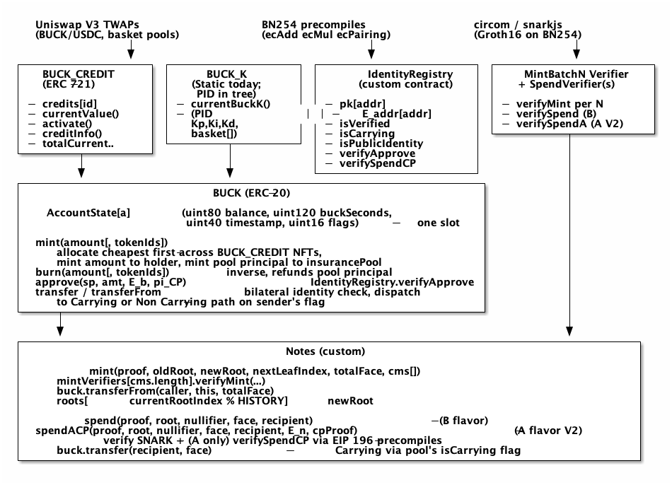

# Copyright (c) 2026 Perry Kundert.  All rights reserved.
# This document is NOT covered by the source-code licences in
# LICENSING.md.  The code is free software; the design writing is not
# (yet) placed under an open licence -- see LICENSING.md, "Design
# documents".  "Alberta Buck" is a mark: see TRADEMARKS.md.
# SPDX-License-Identifier: LicenseRef-AllRightsReserved
#+title: The Alberta Buck - Ethereum Implementation (DRAFT v2)
#+author: Perry Kundert
#+date: 2026-05-24 12:00:00
#+category: Alberta Buck
#+series_order: 9
#+weight: 10
#+draft: false
#+bucky: true
#+math: true
#+description: Ethereum implementation of the Alberta Buck: ERC-721 BUCK_CREDIT for insured-asset NFTs with deterministic depreciation, an identity-bound ERC-20 BUCK with packed-slot per-account state and continuous demurrage, a privacy-preserving IdentityRegistry with PS-credential + ElGamal registration, a BuckBasket direct-mint orchestrator that custodies TOKEN/BUCK Uniswap-V3 LP and recycles "sell high / buy low" on redemption, a Notes commitment pool with Groth16 mint and spend over a Tornado-style incremental Poseidon Merkle tree, and a BUCK_K controller shipped in three variants (static, USD-free direct PID against BuckBasket, and USDT/USDC-basket PID against external Uniswap-V3 TWAPs).

#+EXPORT_FILE_NAME: ./images/alberta-buck-ethereum
#+STARTUP: org-startup-with-inline-images inlineimages
#+OPTIONS: ^:nil
#+OPTIONS: toc:nil

#+LATEX_HEADER: \usepackage[margin=1.0in]{geometry}

#+ATTR_LATEX: :width 10cm
[[https://perry.kundert.ca/images/dominion-logo.png]]

#+begin_abstract
A concrete Ethereum implementation of the [[https://perry.kundert.ca/range/finance/alberta-buck-architecture/][Alberta Buck Architecture]], in six
contracts:

1. *BUCK_CREDIT* (ERC-721) -- one NFT per insured asset, with deterministic depreciation and
   piecemeal client activation.
2. *IdentityRegistry* -- per-address Pointcheval-Sanders credentials and ElGamal-encrypted identity
   points, verified on-chain via the BN254 precompiles.  Trust anchor for every BUCK transfer.
3. *BUCK* (ERC-20) -- identity-bound, single-slot per-account state with /signed/ raw balances,
   continuous demurrage on positive holdings, and NFT-backed credit headroom that lets the raw
   balance go negative up to ~creditLimit(a) = totalCurrentValue(a) * currentBuckK / 1e18~.
   =mint(N)= activates NFT-backed coverage and pays the insurance pool principal out of the
   holder's credit (no BUCK is delivered to the holder's raw balance); the holder spends the new
   headroom by transferring out, driving the signed raw negative.  =balanceOf= reports
   ~held + unused credit~ on non-Carrying accounts, so the ERC-20 view answers /"what can I spend
   right now"/.
4. *BuckBasket* -- the USD-free value anchor, and an ordinary credit holder.  Keeps one
   full-range Uniswap-V3 position per TOKEN/BUCK pool, takes deposits as shares of its equity,
   pairs every TOKEN with BUCKs it issues on its own credit, and pays exits in BUCKs before it
   sells anything.  A permissionless work wheel turns its upkeep.  Publishes
   ~basketValueInBuck() = sum( basketAmount_i * pool_price_in_BUCK_i )~ as the direct-embodiment
   process variable for =BUCK_K=.
5. *BUCK_K* -- the value-stabilization factor for credit-limit computation.  Three implementations
   ship today: =BuckKControllerStatic= (governance-set constant), =BuckKControllerDirect= (USD-free
   PID; setpoint = 1.0 BUCK by definition, process variable = =BuckBasket.basketValueInBuck()=),
   and =BuckKController= (PID against an external four-pool USDT/USDC basket of Uniswap-V3 TWAPs,
   with a BUCK/USDT TWAP as the BUCK price).  The PID mechanics -- priming, setpoint-shift (=dS=)
   compensation, long-gap =dTMax= clamp, =fundingFactor()= counter-cyclical insurance view -- live
   in a shared =BuckKControllerBase= following the ezpwd::pid pattern; =Buck.mint= and =Buck.burn=
   drive =compute()=, and =BuckBasket= holds the privileged hook to =reprime()= after constituent
   additions.
6. *Notes* -- privacy-preserving denomination on top of BUCK.  Mint and spend via Groth16 SNARKs
   over a Tornado-style incremental Poseidon Merkle tree.

This is the first implementation, prioritizing clarity over breadth of standards.  Subsequent
documents will examine ERC-1155, ERC-3643, and ERC-4626 alternatives for individual layers.
#+end_abstract

#+LATEX: \clearpage
#+TOC: headlines 3

#+LATEX: \clearpage
* Contract Architecture

The six contracts compose into a single transfer pipeline gated on identity.  =IdentityRegistry=
is the trust anchor: =mint=, =approve= and =transfer= all consult it before mutating state.  Every
account /and/ contract that touches BUCK carries an identity binding -- EOAs via =register=,
contracts via =bindContract= -- so bilateral identity-checked transfers always have a verifiable
counterparty on both sides.

#+BEGIN_SRC ditaa :file ./images/buck-eth-layers.png :exports results
                          +---------------------+
                          | Alberta Buck Wallet |
                          |  Identity + BUCK    |
                          |   + BuckCredit NFTs |
                          +-+--+--+--+--+--+----+
                            |  |  |  |  |  |
              register      |  |  |  |  |  |  createCredit
              approve     <-+  |  |  |  |  +-> (insurer)
                               |  |  |  |
              mint, burn     <-+  |  |  +-> spend / mint Notes
                                  |  |
                         transfer |  +-> deposit / redeem
            (any Ethereum wallet) |      (BuckBasket)
                                  v

    +-----------+      +-----------+        +-----------+    +-----------+
    |   Notes   |      |           |        |           |    | Identity  |
    | (privacy) +<---->+   Buck    +<------>+BuckBasket |    | Registry  |
    |           | xfer | (ERC 20)  | credit |  shares   |    |  (BN254)  |
    +-----------+      |           |  xfer  | + V3 LPs  |    |           |
                       +-+--+---+--+        +-----+-----+    +-----+-----+
                         |  |   ^                 |                ^
                         |  |   |                 | reprime        |
                         |  |   | basketValue     |                | isVerified
                         |  |   +-----------------+                | (every BUCK
                         |  |                                      |  mover
                         |  | compute                              |  consults)
                         |  v                                      |
                         | +--------+                              |
                         | | BUCK_K |                              |
                         | |  (PID) |                              |
                         | +--------+                              |
                         |                                         |
                         | activateFromBuck                        |
                         | deactivateFromBuck                      |
                         v   (one-way: BuckCredit never calls Buck) |
                       +-+----------+                              |
                       | BuckCredit |<-- createCredit              |
                       | (ERC 721)  |    (insurer)                 |
                       +------------+                              |
                                                                   |
                       (Buck, BuckBasket, Notes all call ----------+
                        IdentityRegistry before settling)
#+END_SRC

#+RESULTS:

A Wallet (EOA) is the only initiator.  It registers once with =IdentityRegistry= and then
mints, burns, transfers, deposits or spends via the contract entry points in the second
row.  Every contract that moves BUCK -- =Buck=, =BuckBasket=, =Notes= -- consults
=IdentityRegistry.isVerified= on both counterparties before settling.  =BuckCredit=
(ERC-721) is mutated only by insurers (=createCredit=, =updateCredit=) and by =Buck= itself
(=activateFromBuck= / =deactivateFromBuck= during mint and burn); the dependency is one-way
-- =BuckCredit= never calls back into =Buck=.  =BUCK_K= is private
infrastructure: =Buck= calls =compute()= on every mint/burn, and =BuckBasket= is the
privileged caller of =reprime()= and the source of =basketValueInBuck()= that the
=Direct= variant integrates against.  External dependencies (not shown): Uniswap V3 (LPs
custodied by =BuckBasket=; TWAPs read by the =External= variant of =BUCK_K=); the BN254
EVM precompiles (pairings for =IdentityRegistry=, modular arithmetic for the
=Mint/SpendVerifier= contracts); circom / snarkjs for off-chain Notes proof generation.

The flow is:

1. A *client* names an insurer it will accept credits from (=setCreditIssuer=), and that
   *insurer* mints a =BUCK_CREDIT= NFT for the client's asset, setting face value, depreciation
   schedule, and =premiumRate= (annual basis points of activated coverage).  A credit only lands
   where its recipient asked for it, and only from an insurer whose regulator has attested it --
   see [[#unvetted-insurers][The Insurer Gate]].
2. There is no separate activation step, and no public =BuckCredit.activate=.  Coverage is
   activated only inside =Buck.mint=, atomically with the insurance principal that funds it --
   see [[#activation][Activation = Mint, Deactivation = Burn]].  While coverage is live the credit
   cannot change hands.
3. Before touching BUCK, the client =registers= with =IdentityRegistry=, posting a blinded
   presentation =(A, B)= of its PS credential, an ElGamal-encrypted identity point and a proof
   tying the two to the account key.  The registry verifies the proof via BN254 pairings
   (443,892 gas measured, paid once per address).
4. =BUCK.mint(amount[, tokenIds])= draws coverage cheapest-first across the client's NFTs,
   activates it, and debits the mutual-insurance pool principal -- 10x the annual premium on the
   coverage -- from the client's /signed/ raw balance into =insurancePool=.  No BUCK is delivered
   to the client's raw balance; what the client gains is spendable headroom.  The arithmetic is
   in [[#mint-burn][mint(N) and burn(N)]].
5. To send BUCK, the sender =approves= with a Chaum-Pedersen receipt that re-encrypts the
   sender's identity under the spender's public key.  =transfer= / =transferFrom= then bilateral-
   identity-check both sides and emit =BuckTransferReceipt= carrying only ciphertext hashes.
6. To denominate as private notes, the client calls =Notes.mint= with a Groth16 proof binding the
   deposited =totalFace= to a batch of Poseidon commitments.  Holders later call
   =Notes.spendCoupledA1= / =A2= / =B1= with a fresh nullifier, a SNARK proving inclusion under a
   recent root, and a deposit gate proving the depositor is the identity the note names, against a
   posted identity root.
7. =BuckBasket= is the *value anchor*, and a credit holder like any other.  Anyone holding a
   basket constituent (as wired by governance via =addBasketToken=), or BUCKs, can call =deposit=
   and receive shares of the basket's equity on an ERC-721 receipt (=BuckBasketReceipt=).  The
   basket pairs the TOKEN with BUCKs it issues on its own [[#marked-credits][marked credit]], as
   full-range V3 liquidity; nothing is sold to place a deposit.  On =redeem= the treasury takes a
   quarter of the receipt's gain, and the rest is paid in BUCKs from the credit line before
   anything is sold.  A permissionless work wheel turns the upkeep: pairing, collecting fees, and
   working each constituent toward a target that leans against its price.  See
   [[#buck-basket-equity][BuckBasket]].
8. =BUCK_K= ships in three forms today.  The governance-set static variant is the simpler choice
   for early deployments where no on-chain price reference exists.  =BuckKControllerDirect= is the
   *USD-free* embodiment: process variable = =BuckBasket.basketValueInBuck()=, setpoint = 1.0 BUCK
   by definition, error = =1.0 - basketValue=.  The legacy =BuckKController= reads its process
   variable (BUCK price) from a BUCK/USDT TWAP and its setpoint (basket cost) from a four-pool
   USDT/USDC basket -- XAUT/USDT, PAXG/USDC, cbBTC/USDC, WBTC/USDT, 25 % each -- chosen for
   resilience against any single basis-currency or asset-token freeze.  =Buck.mint= and =Buck.burn=
   call =BuckK.compute()= regardless of variant, so user activity drives and amortizes the PID;
   long quiet stretches are bounded by =dTMax=, and =BuckBasket= is the privileged caller of
   =reprime()= after =addBasketToken= so dilution discontinuities don't fire a one-cycle P/I
   spike.

* ERC Standard Choice for BUCK_CREDIT

ERC-721 was the obvious starting point and the choice that ships.  Each credit is genuinely unique
(specific asset, depreciation curve, insured value, premium schedule); =ERC721Enumerable= gives
=BUCK.mint= the =tokenOfOwnerByIndex= it needs to walk a holder's NFTs.  ERC-3643 (T-REX) is a
plausible future move if regulatory KYC becomes a hard requirement; ERC-1155 helps only if
standardized credit /classes/ emerge with shared depreciation parameters; ERC-4626 fits the
=InsurancePool= but not individual credits.  None of those are revisited below -- the rest of the
document specifies the shipped ERC-721 path.

* BUCK_CREDIT: ERC-721 Insured Asset NFT
  :PROPERTIES:
  :CUSTOM_ID: buck-credit
  :END:

Each =BUCK_CREDIT= is an =ERC721Enumerable= token whose per-token =CreditParams= holds the insurer's
current offer and the client's activation state.  Three roles touch it: the *insurer* mints and
updates, the *client* activates, =BUCK= reads the depreciated activated value to size mint
allocations.  All monetary fields are in 6-decimal BUCK-equivalent units (USDC-compatible).

** Data Model

Fields group by mutability:

Issuance is opt-in per (client, insurer) pair: =createCredit= reverts unless the client has
called =setCreditIssuer(insurer, true)=, and -- where the gate is configured -- unless the
insurer's regulator has attested an envelope covering the credit ([[#unvetted-insurers][The
Insurer Gate]]).  Nobody can put a credit in your hands uninvited, or write one beyond their
licence.

- *Immutable at mint*: =insurer= (the address allowed to update this token), =assetClass=,
  =createdAt=.
- *Insurer-mutable* via =updateCredit=: =faceValue=, =depreciationFloor=, =depType=, =depRate=,
  =depStartAt=, =premiumRate=, =lastUpdated=.  =faceValue= may not be reappraised below
  =activatedValue= -- see [[#insurer-updates][Insurer Updates]].
- *Buck-mutable* via =activateFromBuck= / =deactivateFromBuck=: =activatedValue= (capped at
  =faceValue=).  The client never writes it directly.

=DepreciationType= is one of =NONE= (land, gold), =LINEAR= (constant annual reduction),
=DECLINING_BALANCE= (continuous-compounded percentage), or =MARKED= (valued at its insurer's
latest mark: [[#marked-credits][Marked Credits]]).  Four events -- =CreditCreated=,
=CreditUpdated=, =CreditActivated=, =CreditMarked= -- record every state change.

A credit does not age.  Jubilee relief accrues on the BUCK an account has actually drawn -- its
lien, in =Buck= -- not on coverage ([[#demurrage][Demurrage and Jubilee]]).

** Depreciation Models

=currentValue(tokenId)= is a pure view that branches on =depType=:

- =NONE=: returns the activated face value, unchanged.
- =LINEAR=: loss accrues at =depRate= bp/year on the depreciable portion (=faceValue - floor=),
  clamped at =depreciationFloor=.
- =DECLINING_BALANCE=: discrete whole-year compounding -- the factor =(BP - depRate)/BP= is
  applied once per complete year via a loop capped at 100 years, then a linear interpolation
  bridges the trailing partial year.  No transcendental approximations.

In every case the activated portion depreciates proportionally:
~currentValue = depreciatedFace * activatedValue / faceValue~.

| Asset         | Type              | Rate   | Floor | 30yr value (of $100K) |
|---------------+-------------------+--------+-------+-----------------------|
| Land          | NONE              | --     |    -- | $100,000              |
| House (bldg)  | LINEAR            | 200bp  |   20% | $52,000               |
| Vehicle       | DECLINING_BALANCE | 1500bp |    5% | $5,725                |
| Farm equip    | DECLINING_BALANCE | 1000bp |   10% | $13,815               |
| Gold in vault | NONE              | --     |    -- | $100,000              |

A residential property would typically have two BUCK_CREDITs: one for the land (NONE) and one for
the structure (LINEAR or DECLINING_BALANCE with a salvage floor).

** Marked Credits
   :PROPERTIES:
   :CUSTOM_ID: marked-credits
   :END:

Some collateral is revalued on-chain every block -- a BuckBasket's equity is the case in point --
and no depreciation schedule describes it.  A =MARKED= credit is valued at a mark its insurer
keeps current, =mark(tokenId, value)=:

#+BEGIN_SRC text
depreciatedFaceValue(tokenId) = min(faceValue, markOf[tokenId])        (MARKED)
currentValue(tokenId)         = depreciatedFaceValue * activatedValue / faceValue
#+END_SRC

so with the whole face activated, =currentValue= is the mark and the holder's =creditLimit= is
=K x mark=.  Like depreciation, the mark moves the limit without touching the coverage: it may
fall below =activatedValue=, and a holder whose lien then exceeds its limit is under water -- it
cannot spend further credit, and nothing is called back.

That is exactly what an insurer must never be able to do to someone else: a mark written down on
another's credit would revoke a purchased policy, which [[#insurer-updates][Insurer Updates]]
forbids.  So three rules bound it:

- *Self-issued only.*  =createCredit= with =MARKED= requires =client == msg.sender=: the holder is
  its own insurer, and marks only its own collateral.
- *Fixed at creation.*  =updateCredit= refuses to switch a credit to or from =MARKED=, so a
  scheduled credit cannot be converted and then marked down.
- *Gated like any model.*  Where the insurer gate is configured, the insurer's attested envelope
  must permit =MARKED= (bit 3 of =depTypes=), as it must permit any depreciation model.

A marked credit is activated like any other -- one =Buck.mint= at zero premium, once the mark is
above zero (a credit appraised at zero insures nothing and is skipped) -- and its holder's lien
earns relief like any other.  Its face caps what the holder can ever draw, at =K x face=.

** Activation = Mint, Deactivation = Burn
   :PROPERTIES:
   :CUSTOM_ID: activation
   :END:

There is no public =BuckCredit.activate()= function.  Activation -- expanding =activatedValue=
and thus growing the holder's =creditLimit= -- happens /only/ atomically as part of
=Buck.mint(N, [tids])=, and deactivation happens /only/ atomically as part of =Buck.burn(N,
[tids])=.

This is a deliberate consequence of the mutual-insurance pool model.  Drawing =take= units of
coverage on an NFT generates ~annual_premium = take * premiumRate / BP~ per year.  Instead of
charging that premium on a continuous schedule, the contract requires an /upfront/
~poolPrincipal = annual_premium * POOL_ROI_INV~ deposit (where ~POOL_ROI_INV = 10~ encodes the
insurer's assumed 10 % annual ROI on pool capital).  At parity, the pool's investment yield on
=poolPrincipal= exactly funds the annual premium on =take= in perpetuity -- so /a policy is a
one-time purchase/, not a recurring expense.

Therefore the surface =BuckCredit= exposes is restricted to (a) insurer-side creation /
re-appraisal (=createCredit=, =updateCredit=), (b) standard ERC-721 ownership operations
(=transferFrom=, =balanceOf=, =ownerOf=, ...), and (c) two Buck-only entry points
(=activateFromBuck=, =deactivateFromBuck=) which =Buck._allocateMint= / =_allocateBurn= call as
part of their atomic sequences.  Test fixtures that need to set up a holder with non-zero
=creditLimit= without exercising the mint() purchase path use the =BuckCreditHarness=
subclass's =forceActivate= -- explicitly not present on production =BuckCredit=.

=Buck.mint= and =Buck.burn= are the only callers.  Their per-NFT arithmetic, and the post-burn
solvency rule that goes with it, are in [[#mint-burn][mint(N) and burn(N)]].

*A credit that is backing BUCK cannot change hands.*  =BuckCredit._update= -- the ERC-721 hook
every mint, transfer and burn passes through -- refuses to move a token whose =activatedValue= is
non-zero, with =BuckCredit: credit in use=.  Minting is exempt (=from == address(0)=), so
=createCredit= still works, and a burn that takes coverage back to zero frees the credit to be
sold again.

The reason is that the two halves of a credit position live in different places.  =Buck= derives
the holder's =creditLimit= from the activated value of the credits they /own/, while the BUCK
drawn against that limit stays as a negative raw balance on the account that /drew/ it.  Let the
token move and the two separate: the seller keeps an obligation with nothing behind it, and the
buyer receives headroom against coverage that has already been spent.  The same activated value
would back BUCK twice.

=activatedValue= is the predicate rather than =Buck='s =mintsBacked= deliberately: it is local,
so =BuckCredit= enforces the property without consulting =Buck= at all, and the guarantee does not
depend on another contract being correct or even reachable.  The two agree by construction --
activation happens only inside =Buck._allocateMint=, and =updateCredit= may not reappraise below
activated coverage.

=totalCurrentValue(account)= walks =tokenOfOwnerByIndex= and sums =currentValue(tokenId)= -- the
single call =Buck.creditLimit= makes to size the holder's headroom (then multiplied by
=currentBuckK= and divided by =1e18=).  =creditInfo(tokenId)= returns
=(faceValue, activatedValue, premiumRate)= one NFT at a time;
=batchCreditInfo(uint256[] tokenIds)= returns a packed ~CreditSlice[] = (owner, faceValue, activatedValue, premiumRate)~
for the entire list in one external call, used by =Buck=
=_allocateMint= / =_allocateBurn= to amortize per-NFT cross-contract dispatch overhead.

** Buck Wiring

The dependency is one-way: =Buck= reads =BuckCredit= to size credit, and =BuckCredit= never
calls =Buck=.  =BuckCredit.setBuck(address)= is a one-shot post-deployment authorisation record
-- it names the single contract allowed to call =activateFromBuck= / =deactivateFromBuck= -- and
nothing more.

Earlier drafts had =BuckCredit= notify =Buck= on every NFT mutation, so that a per-block
credit-limit cache in =Buck= could invalidate.  Both the cache and the notification are gone; see
[[#credit-limit][The Credit Limit Is Read Live]] for why the cache could not have been made correct.
Removing them left the call graph acyclic, which is worth more than the cache was: there is no
reentrant path from =BuckCredit= back into =Buck=, so =Buck='s reentrancy guard needs no
exemption for one.

The two-contract split, rather than collapsing into a single Diamond, is forced by the
ERC-20 / ERC-721 standards: =balanceOf(address)= and =transferFrom(address,address,uint256)= share
function selectors with incompatible semantics across the two standards, and the =Transfer= event
has different indexed-argument counts.  A Diamond can dispatch one selector per signature;
whichever loses stops being standards-compliant and silently breaks wallets, indexers,
marketplaces, and routers.  See [[#future][Future Directions]] for the modularization paths that /are/
viable (intra-ERC-20 facets in =Buck=, independent UUPS for =BuckCredit=).

** Insurer Updates
   :PROPERTIES:
   :CUSTOM_ID: insurer-updates
   :END:

=updateCredit(tokenId, newFaceValue, newDepreciationFloor, newDepType, newDepRate,
newDepStartAt, newPremiumRate)= is gated on ~msg.sender == credits[tokenId].insurer~.
=assetClass= and =insurer= never change.

*An insurer may reappraise down to the coverage the holder has already bought, and no further*:
~newFaceValue >= activatedValue~, else =BuckCredit: face below activated coverage=.  Activated
coverage is a completed purchase -- its pool principal was paid up front and funds its premium in
perpetuity -- so writing it down revokes a policy rather than revaluing an asset.  An asset that
has genuinely lost value is what a *claim* is for; ordinary decline is what the depreciation
schedule is for, and that still moves the holder's credit limit continuously without touching the
coverage itself.  Every other lever stays: =faceValue= down to the activated line, the schedule,
the floor, the premium rate.

The rule is also load-bearing for solvency.  =activatedValue= lives in =BuckCredit= and
=mintsBacked= lives in =Buck=; the burn is sized from the second and checked against the first.
An earlier draft let a reappraisal clamp one without the other, and a holder whose credit was
written down could then never unwind the position -- burnable only down to the clamped line, with
the remainder stuck and the credit permanently disqualified from backing BUCK again.  Refusing
the clamp keeps the two equal by construction, which is also what makes the transfer lock in
[[#activation][Activation = Mint]] the right predicate.

A reappraisal, or ordinary depreciation, can still leave a holder's outstanding BUCK above their
credit limit.  That is a supported state, not a default: see [[#underwater][Underwater Is a State, Not a
Failure]].

* IdentityRegistry: On-Chain Trust Anchor
  :PROPERTIES:
  :CUSTOM_ID: identity-registry
  :END:

The =IdentityRegistry= is the binding between Ethereum addresses and the privacy-preserving
identity machinery described in the companion documents [[https://perry.kundert.ca/range/finance/alberta-buck-identity/][Identity with Anonymity]],
[[https://perry.kundert.ca/range/finance/alberta-buck-identity-example/][Identity Example -- Data Flow]], and [[https://perry.kundert.ca/range/finance/alberta-buck-proofs][Cryptographic Proofs]].
Every BUCK =mint=, =approve= and =transfer= consults this registry; an unregistered address cannot
hold or move BUCKs.

The registry stores per address: =pk[a]= (G_1 identity public key), =E_addr[a]= (ElGamal ciphertext
of the identity point M), =isVerified= (true after PS+NIZK pass on-chain or after =bindContract=),
=isCarrying= (controls Buck's transfer dispatch), and =isPublicIdentity= (true only for contracts
bound with the public-disclosure flag).  Trusted-issuer PS public keys live in
=trustedIssuers[issuerAddr]=, populated by governance.  EOAs always self-register; contracts always
=bindContract=.

** Cryptographic Surface

Four on-chain verifications, all reducible to BN254 precompile calls:

1. *PS credential presentation at registration*: the holder publishes
   ~(A, B) = (a * sigma_1, a * sigma_2 + b * Y1)~ for fresh ~a, b~, with ~Y1 = y * G~ the issuer's
   G1 key component, and the registry checks the masked relation
   ~e(B, g_2) = e(A, X) * e(m * A + b * G, Y)~ through the proof in step 2 -- one three-pair
   pairing product.  The published pair is uniform whatever the identity, so no holder of ~m~
   (the issuer included) can test it; a rerandomized signature, which an earlier design
   published, would be a valid signature on ~m~ and testable by anyone holding it.
2. *Schnorr-family NIZK* binding the presentation to the ElGamal ciphertext and the account
   key.  Four response scalars over one credential commitment ~C1 = m~ * A + b~ * G~ (so no
   field exposes ~m * A~ alone), Fiat-Shamir bound to the action/version domain
   (=AlbertaBuck/FiatShamir/IdentityRegistry/Register/v2=),
   =((A, B), E_new, pk_new, registrant_address)=, chain ID, and registry deployment.
   Total registration 443,892 gas measured (472,630 before the presentation), paid once per
   address; =trustIssuer= additionally checks ~e(Y1, g_2) = e(G, Y)~ once per issuer.
3. *Chaum-Pedersen NIZK at =approve=*: proves the recipient's identity ciphertext re-encrypts the
   same M registered in =E_alice= and that the sender holds the registered account key.
   Fiat-Shamir binds the registry deployment, =msg.sender=, =spender=, =chainid= and the
   =.../Approve/v2= domain word.  ~29K gas per counterparty pair.
4. *The Notes bindings*, each a sigma over EIP-196 with its own v2 domain word: the public
   issuer's batch Schnorr (=verifyIssuerSchnorr=), the private issuer's recipient-blinded
   re-encryption (=verifyIssuerReenc=), and the bearer depositor's binding
   (=verifyDepositorBinding=).  The addressed deposit gate is a folded Groth16 proof, not a sigma
   ([[#notes][Notes]]).
5. *Public membership* (=verifyPublicMembership=): a Poseidon path through a public subtree and
   the aggregator, checked on chain for the [[#unvetted-insurers][insurer gate]].

Every hash the protocol relies on carries a domain tag of the form =AlbertaBuck/<Area>/<Name>/v2=:
the Fiat-Shamir transcripts end in one, the identity scalar hashes one ahead of the certified
record, and each accumulator leaf leads with one as a field element.

** Solidity Surface

=src/IdentityRegistry.sol= uses the =BN254= helper for all curve math:

#+BEGIN_SRC solidity
struct G1Point  { uint256 X; uint256 Y; }
struct G2Point  { uint256[2] X; uint256[2] Y; }

struct ElGamalCT { G1Point R; G1Point C; }      // (R, C) = (r*G, r*pk + M)
struct PSPresentation { G1Point A; G1Point B; }   // (a*sigma_1, a*sigma_2 + b*Y1)
struct PSPubKey  { G2Point X; G2Point Y; G1Point Y1; }   // Y1 = y*G, checked at trustIssuer

struct RegistrationProof { uint256 e, s_m, s_b, s_r, s_sk; G1Point C1, T_C, T_R, T_key; }
struct CPProof           { uint256 e, s1, s2;   G1Point T1, T2, T3;     }
struct ContractBindingProof { uint256 e, s;     G1Point T;              }
struct SchnorrProof, IssuerReencProof, DepositorBindingProof;   // the Notes bindings

function register(address issuer, G1Point pk, ElGamalCT E,
                  PSPresentation pres, RegistrationProof proof);
function authorizeContractBinding(address binder, G1Point pk, ElGamalCT E,
                                  bool isPublicIdentity_, bool isCarrying_);
function bindContract(address target, G1Point pk, ElGamalCT E,
                      bool isPublicIdentity_, bool isCarrying);
function bindContract(address target, address issuer, G1Point pk, ElGamalCT E,
                      PSPresentation pres, RegistrationProof credential,
                      ContractBindingProof holderAuthorization,
                      bool isPublicIdentity_, bool isCarrying);
function bindContractFromAdapter(address target, address operator,
                                 bool isPublicIdentity_, bool isCarrying);
function setBindingAdapter(address adapter, bool approved);        // governance
function trustIssuer(address issuer, PSPubKey ipk);                 // governance
function verifyApprove(address sender, address spender,
                       ElGamalCT E_bob, CPProof pi) view returns (bool);
function verifyIssuerSchnorr(...) / verifyIssuerReenc(...) / verifyDepositorBinding(...);

// The identity accumulator (see The Identity Accumulator)
function setRootAuthority(address next);                             // governance
function enrollSubtree(bytes32 id, uint32 slot, uint8 depth, bool isPublic,
                       address poster, string publication);          // root authority
function evictSubtree(bytes32 id);                                   // root authority
function setAggregator(address next);                                // root authority
function postIdentityRoot(uint256 root, bytes32 leafListHash);       // aggregator
function setMaxRootAge(bytes32 consumer, uint32 maxAge);             // governance
function acceptsRoot(uint256 root, bytes32 consumer) view returns (bool);
function verifyPublicMembership(bytes32 id, uint256 leaf, uint256[] subSiblings,
                                uint256 subIndex, uint256[] aggSiblings, uint256 root)
                                view returns (bool);
function markApproved(address spender);                              // Buck-only
function setBuck(address buck);                                      // governance, one-shot
#+END_SRC

A few non-obvious points:

- =verifyApprove= reads =E_alice= from registry storage so the caller cannot substitute a fake
  credential.  Its transcript binds the verifying registry address, so a proof prepared for a
  different registry deployment is rejected.  Here "registry" means =address(this)= while the
  proof is verified: for a Diamond facet that is the stable Diamond proxy, not the replaceable
  facet implementation.  Replacing a facet therefore does not invalidate proofs.  Moving the
  registry to a different proxy requires unsubmitted registration/approve proofs to be regenerated
  (and registry state to be migrated), but does not alter already minted Notes or their receipts;
  those artifacts do not contain either proof.
- =bindContract= requires both certification and target control.  The compact overload copies a
  registered caller's exact stored identity after the target authorizes the full binder/identity/
  policy tuple.  The credential overload verifies PS certification plus holder authorization;
  target authorization remains mandatory on that path.  Contracts with known provenance use a
  governance-approved, contract-specific adapter.  The adapter proves canonical provenance and
  authority, while the registry copies the named operator's stored identity rather than accepting
  adapter-supplied keys.  The first authorized binding is immutable.
- =markApproved= (called by Buck inside =approve=) freezes the spender's =isCarrying= flag the
  first time anyone successfully approves them, so the carrying flavor a sender consents to cannot
  be retroactively flipped.
- Revocation does not un-register existing accounts; they were verified once and are never
  re-verified.

** Public-Identity Contracts

DeFi infrastructure -- AMM pools, vaults, oracles, the Notes pool -- can't generate Chaum-Pedersen
proofs at =approve= time because the contract has no private key.  Such contracts authorize and
bind a certified operator identity, or use an approved adapter with audited provenance and
authority semantics, with
~isPublicIdentity_=true, isCarrying=true~.  Counterparties of a
Public-Identity contract still call the identity-bound =approve= (the always-CP rule applies
regardless of spender flavor), but the receipt-fragment check on the contract side is satisfied by
the deterministic =_identityHash= rather than a per-counterparty CP receipt.  Public-Identity
contracts forfeit content privacy: their identity M is openable on subpoena via the operator's
off-chain attestation.  Encrypted-Identity contract binding (=isPublicIdentity_=false=) is
supported by the surface but not yet used in production.

** Issuer Trust

=trustedIssuers= is the only governance-controlled trust anchor.  Adding an issuer admits a new
origin of registrable identities; removing one stops new registrations under that issuer.  Existing
registrations are unaffected -- they were verified at registration and never re-verified.
Whether a registered identity is in good standing is a separate, revocable fact: membership in its
registry's subtree of the identity accumulator, which every consumer that needs liveness proves
against a posted root of bounded age -- see
[[https://perry.kundert.ca/range/finance/alberta-buck-identity/#epoch-based-renewal][Identity: Liveness Is Membership]].

** The Identity Accumulator
   :PROPERTIES:
   :CUSTOM_ID: accumulator
   :END:

Governance appoints a =rootAuthority= (=setRootAuthority=), which enrolls each certifying
authority's subtrees at aggregator slots (=enrollSubtree(id, slot, depth, isPublic, poster,
publication)=, =evictSubtree=) and appoints the =aggregator= (=setAggregator=).  The aggregator
alone posts roots: =postIdentityRoot(root, leafListHash)= writes =identityRoot= and records the
root and its posting time in a ring of =ROOT_RING_SIZE= = 256, evicting the oldest.  A consumer
names itself by a v2 tag and =acceptsRoot(root, consumer)= accepts a retained root posted within
that consumer's maximum age (=setMaxRootAge=; Notes seven days, the insurer gate one day, never
longer than the full ring covers).  Paths are =MEMBERSHIP_PATH_DEPTH= = 32 levels: a subtree of
12 under an aggregator of 20.  =verifyPublicMembership(id, leaf, subSiblings, subIndex,
aggSiblings, root)= checks a public subtree's path on chain, taking the aggregator index from the
subtree's enrolled slot rather than from the caller, and =publicIdentityLeaf(M)= is the tagged
unsalted leaf.  Private (salted) membership is proven in zero knowledge inside the Notes gates.
=register= and =bindContract= refuse a caller-supplied leaf: admission is the authority's
certification, never a by-product of registration.

* BUCK: ERC-20 Token
  :PROPERTIES:
  :CUSTOM_ID: buck-erc20
  :END:

BUCK is an identity-bound ERC-20 with NFT-backed credit headroom, mutual-insurance-pool minting,
and continuous demurrage.  All transfer-path state for an account fits in one storage slot, so a
transfer is one SSTORE per side.  =mint(N)= opens enough NFT-backed insured-asset coverage to
deliver =N= units of /spendable headroom/ to the holder (no BUCK is delivered to raw balance) and
simultaneously transfers a /pool principal/ from the holder's signed raw to =insurancePool=,
sized so that at the insurer's assumed annual ROI the principal's investment yield exactly covers
the annual premium on the activated coverage.  The holder spends the headroom by transferring
out, which drives their signed raw negative; =burn(N)= unwinds coverage most-expensive-first and
refunds principal back to the holder, lifting their signed raw toward zero.  Every transfer
routes through the =IdentityRegistry= and emits =BuckTransferReceipt(from, to, amount, fromHash,
toHash)= -- ciphertext hashes, no plaintext identity on chain.

** Storage Layout

The transfer-path state for an account is one slot:

#+BEGIN_SRC solidity
struct AccountState {
    BuckQty     balance;       // int80 underlying; signed.  Range = [-6.04e23, +6.04e23] raw
                               // = [-6.04e17, +6.04e17] BUCK at 6 decimals.  Negative ==
                               // NFT-backed used credit; positive == held BUCK.
    BuckSeconds buckSeconds;   // uint120 underlying; |balance| * dt, read by sign:
                               // fee-seconds while positive, issuance-seconds (the
                               // lien over time) while negative, 0 at zero (I1)
    uint40      timestamp;     // last crystallisation (safe past year 36800)
    uint16      flags;         // bit 0: demurrage routed to demurragePayer[a].
                               // bits 1-15 reserved.
}
mapping(address => AccountState) internal _state;
#+END_SRC

=BuckQty= is a user-defined value type wrapping =int80=; constructors
=toBuckQty(uint256)= (bounds-checks against the positive cap) and =toBuckQtySigned(int256)=
(bounds-checks both endpoints) live in =BuckTypes.sol= so a future width change propagates to
=Buck= and =BuckCredit= in lockstep.  =BuckCredit= always reads via =asUint()= (its face,
floor, and activated values are non-negative by construction); =Buck= reads via =asInt()= in
signed contexts and =asUint()= only after verifying non-negativity.

A bit in =flags= is the cheapest state this contract has: the word rides in the slot the transfer
path already loads and stores, so testing one is free.  That is exactly why it is spent only on
hot-path dispatch.  Cold-path bookkeeping -- the count of accounts a demurrage payer carries --
lives in its own mapping instead.

A balance changes sign only at a write, after =_crystallize= has folded the old side's rectangle
through the current block, so the old side's seconds are settled there (a fee realized, or relief
paid) and the new side's start at zero.  Invariant I1 -- a zero balance holds no seconds -- is
kept by every writer that can produce a zero, so the field's meaning is given by the sign alone.

The slots, grouped by concern:

| slot | variable                | what it holds                                                    |
|------+-------------------------+------------------------------------------------------------------|
|    0 | =_state=                | the packed per-account word above                                |
|    1 | =_totalSupply=          | sum of the positive balances, the Jubilee fund's excluded        |
|    2 | =_allowances=           | ERC-20 allowances                                                |
|    3 | =_receiptFragments=     | the identity-bound approve's receipt per (from, to)              |
|    4 | =mintsBacked=           | coverage outstanding per credit, in face units (= its activated value) |
|    5 | =mintsPrincipal=        | the insurance deposit held against it                            |
|    6 | =_jubileeLastUpdate=    | through when the fund has accrued                                |
|    7 | =feesRealized=          | fees taken out of circulation, cumulative                        |
|    8 | =reliefRealized=        | relief paid out of the fund, cumulative                          |
|    9 | =demurragePayer=        | an account's accepted fee payer                                  |
|   10 | =demurragePayerRequest= | a pending payer election                                         |
|   11 | =sponseeCount=          | how many accounts a payer carries                                |

Tests that seed state by slot number (where the public path would need the identity machinery)
go through =test/harness/BuckSlots.sol=, and =test/BuckSlots.t.sol= pins each slot against the
live layout.  *Nothing derived is stored.*  An account's credit limit, and therefore
its =balanceOf=, is recomputed from live =BuckCredit= state on every read; there is no cached copy
of it anywhere.  =mintsPrincipal= is not an exception -- it is a record of what was actually paid,
which no amount of present-day state can reconstruct once the appraisal or the rate has moved.

=BUCK= implements =IERC20= and =IERC20Metadata= directly -- no OpenZeppelin ERC20 inheritance, so
the slot layout is explicit and the transfer paths are linear (no =_update= override re-entry).
Decimals are 6, matching USDC.

** Signed Balances and =balanceOf=

=signedRawBalanceOf(a)= returns the raw =int80= directly; =rawBalanceOf(a)= clamps negatives to
zero for legacy ERC-20-style readers; =signedBalanceOf(a)= subtracts demurrage from positive raw
(returns raw directly for negative raw, since used credit accrues no demurrage).  =balanceOf(a)= --
the ERC-20 view -- answers /"what alice can spend right now"/:

#+BEGIN_SRC text
held(a)         = max(0, signedRaw(a) - feeOwing(a))             // Non-Carrying
used(a)         = max(0, -signedRaw(a))
unusedCredit(a) = max(0, creditLimit(a) - used(a))
balanceOf(a)    = held(a) + unusedCredit(a)                      // Non-Carrying
balanceOf(a)    = max(0, signedRaw(a))                           // Carrying
#+END_SRC

Carrying accounts (AMM pools, Notes pool, Jubilee) hold no BuckCredit NFTs, so
~creditLimit == 0~ and the signed-balance machinery degenerates to the prior unsigned model.
=feeOwing= and =balanceOfFees= clamp to zero on negative raw -- demurrage is a per-second
property of *held* BUCK, not used credit.

*** The Credit Limit Is Read Live
    :PROPERTIES:
    :CUSTOM_ID: credit-limit
    :END:

~creditLimit(a) = totalCurrentValue(a) * currentBuckK / 1e18~ is computed from scratch on every
read.  This is the point of BUCK_CREDIT, not an oversight: a holder's spendable balance is meant
to move when they acquire a credit, when an insurer reappraises one, when an asset depreciates on
its schedule, and when BUCK_K moves under the whole system.  A =balanceOf= that did not move with
those would be reporting the wrong number.

An earlier draft cached the product per block, invalidated by an NFT-mutation hook from
=BuckCredit=.  That could not have been made correct.  BUCK_K moves inside any =mint= or =burn=
that advances the PID -- from any account, with nothing to announce it -- so two transactions in
one block were enough to read a stale limit; and no hook can cover depreciation at all, which is
continuous.  The cache never populated in practice, and it was removed along with the hook rather
than repaired.

The cost lands where it should:

| =creditLimit(a)= for ...                        |    gas |
|-------------------------------------------------+--------|
| an account with no credits                      |  6,327 |
| an account with 10 credits, =NONE= schedule     | 27,603 |
| one credit, 40 years into =DECLINING_BALANCE=   | 11,925 |

An account holding ten insured assets pays for ten insured assets on every outbound transfer.  An
account with a plain positive balance pays one external call that returns zero, and a Carrying
account never reaches the credit path at all.  That distribution is deliberate: drawing on
insured collateral is a more expensive operation than spending cash, and it should read that way
on the gas meter.

** mint(N) and burn(N)
   :PROPERTIES:
   :CUSTOM_ID: mint-burn
   :END:

=mint(uint256 amount)= and =mint(uint256 amount, uint256[] calldata tokenIds)= are the two
overloads.  The no-arg form runs an internal cheapest-first selector (insertion sort over the
caller's NFT list -- typically a handful) to minimise premium cost; the second form takes a
caller-supplied order an off-chain optimizer pre-computes against effective rate, depreciation, or
coverage midpoint.

*=amount= is spendable, at the K the mint runs at.*  =mint(amount)= raises the caller's
=balanceOf= by =amount=: it activates whatever coverage, and pays whatever deposit, that takes at
today's =BUCK_K=.  A caller who wants 50,000 to spend asks for 50,000, whatever K is; the coverage
it activates is the dependent quantity, larger when K is lower.  A mint for more than the listed
credits can give reverts ("insufficient credit allocation"), with one exception:
=mint(type(uint256).max)= delivers everything they can give, activating their whole faces.  That
is how a holder opens all of a credit at once -- a SimLP seeding a pool, or a
[[#buck-basket-equity][BuckBasket]] opening its marked credit -- without computing
~K x face~ first and racing K to the block.

=burn(uint256 amount)= mirrors the overload pair: it lowers the caller's spendable by =amount= at
the K it runs at, releasing coverage and refunding its deposit.  It moves no held BUCK; the
caller must still be within their limit afterwards.  The default selector walks the holder's NFTs
*most-expensive-first* -- the dearest insurance is released first, returning the largest pool
principal per BUCK released and freeing expensive coverage capacity for re-use.  The asymmetry
is not arbitrageable: at one K the per-NFT inversion is symmetric (the same ~K - e~ on both
sides), so a mint-burn round-trip on the same NFT restores both its =mintsBacked= and
=activatedValue=, to rounding.

*** The Per-Credit Inversion

Two quantities have to be kept apart, and the whole inversion turns on the difference.

=activatedValue= is denominated in *face* units -- a slice of the asset /as appraised at issue/.
What is actually insured today is that slice scaled by ~rho = depreciatedFace / faceValue~.  That
is proportional coinsurance, and it is the right shape for a depreciating asset: the holder's
share of the asset stays constant while its worth tracks the asset.  =creditLimit= reads the
scaled figure, so the allocator inverts in *present insured value* and grosses back up into face
units at the end.

Each credit carries an annual =premiumRate= in basis points, and *the premium is charged on what
is actually insured* -- the present value, not the face slice.  You pay for the cover you have,
not for the cover the asset used to be worth.  A unit of present insured value raises the credit
limit by =K= and costs a deposit of ~e = r * POOL_ROI_INV / BP~, so it yields ~K - e~ of
spendable.  Given a target spendable =amount=, rate =r= and today's =K=:

#+BEGIN_SRC text
e         = r * POOL_ROI_INV / BP          the deposit per unit of cover (K > e, or the credit is skipped)
V         = ceil(amount / (K - e))         present insured value that yields `amount`
principal = floor(K * V) - amount          the deposit, ~ e * V
take      = ceil(V * faceValue / depreciatedFace)     face units that carry V
#+END_SRC

At ~POOL_ROI_INV = 10~ the pool deposit is ten times the annual premium on =V=, so at the
insurer's assumed 10 % ROI its yield funds that premium in perpetuity; the insurer keeps any
return above 10 % as profit.  When ~rho = 1~ the last line is the identity and this reduces
exactly to the undepreciated case; at ~K = 1~ it is ~V = amount / (1 - e)~, ~principal = V -
amount~.  A credit whose deposit rate reaches K (~e >= K~: a premium of 750bp at K 0.75) can
deliver nothing and is skipped.

Charging the premium on present value is not merely fairer, it is the only formulation that does
not fall over.  Charge on the face slice instead and the inversion becomes
~take = amount / (rho * K - e)~, which is unsatisfiable once ~rho * K <= e~: a 200bp credit would
become unmintable at /any/ price below 20 % of face at K = 1, because depreciation had eaten the
premium margin.  With the premium on =V=, ~K - e~ is independent of =rho=, every credit with a
non-zero appraisal still works, and the cost per BUCK delivered stays ~e / (K - e)~ however old
the asset is.  That last property is why cheapest-first by =premiumRate= remains the correct
selector: depreciation changes how much *capacity* a draw consumes, never how much it *costs*.

The allocator (=_allocateMint=) walks =BuckCredit.batchCreditInfo(tokenIds)= once, then iterates
in memory.  Per credit the available present value is ~capV = (faceValue - mintsBacked) * rho~
and the spendable it can yield is ~capV * (K - e)~; the credit is either fully consumed or
partially consumed via the closed form above to land exactly on =remaining=.  A credit whose
appraisal has reached zero insures nothing and is skipped.  For each credit touched,
=_allocateMint= calls =BuckCredit.activateFromBuck(tid, holder, take_i)= to grow
=activatedValue= and =mintsBacked= in lockstep -- the activation and the principal payment are
the same atomic operation.

*** Releasing: the Deposit Comes Back

The release side is deliberately *not* the mirror of the draw.

Drawing prices coverage: how much deposit does this much cover cost, at today's appraisal and
today's rate.  Releasing does not re-price anything.  It hands back the deposit the coverage is
carrying, pro rata on the face units let go:

#+BEGIN_SRC text
capV   = mintsBacked * rho                     present value of the outstanding cover
netCap = K * capV - mintsPrincipal             spendable it can release: its limit less the deposit
units  = ceil(amount * mintsBacked / netCap)   face units to deactivate
refund = mintsPrincipal * units / mintsBacked  the deposit those units carry
#+END_SRC

The distinction only shows once the appraisal moves, and then it is the whole point.  A holder
who buys cover at one appraisal and releases it at a lower one gets *their whole deposit back*,
not the fraction the shrunken cover would cost today.

That follows from what the deposit is.  The pool's yield on it funds the premium in perpetuity --
that is what makes a policy a one-time purchase rather than a recurring expense -- so what the
holder actually pays for cover is the /opportunity cost/ of the deposit, not the deposit.
Re-pricing on the way out would charge them twice for one decline: the pool has already been
compensated for holding an over-sized deposit against shrinking cover, because it earned its
assumed ROI on the full deposit the whole time while owing premium only on what was still
insured.  Keeping the surplus principal as well would be helping itself twice.

The deposit is stored, in =mintsPrincipal[tokenId]=, rather than recomputed.  It cannot be
recovered from present-day state: it is the sum over past draws of ~V_i * effRate_i / BP~, and
both the appraisal and the premium rate may have moved between them, so ~mintsPrincipal /
mintsBacked~ is a weighted average with no closed form.

Two properties fall out.  ~K * capV <= mintsPrincipal~ means the position has no spendable left
in it -- the holder is underwater and must repay before releasing, which is the same rule the
post-burn solvency check enforces, reached from the other direction.  And when the holder holds
no loose BUCK, ~netCap == creditLimit - used == balanceOf~: *burning exactly their spendable
closes the position and squares the deposit*.  A mint and an immediate burn of the same amount
cancel exactly; partial releases floor, so the dust stays in the pool until the final release
hands it back.

Per-NFT bookkeeping: =mintsBacked[tokenId]= tracks the cumulative outstanding allocation against
each NFT, capped at =faceValue=.  The invariant ~mintsBacked[tid] == activatedValue[tid]~ holds
at every observation point, kept by two rules: activation happens only inside =_allocateMint=
(there is no public =BuckCredit.activate()=), and =updateCredit= may not reappraise below
activated coverage.  They grow together on mint and shrink together on burn.  The burn allocator
sizes its unwind from ~min(mintsBacked, activatedValue)~ anyway -- with the rules above they
cannot differ, and the clamp is there so that any future divergence costs the system a rounding
rather than costing a holder their exit.  A mint-burn round-trip on the same NFT order at one K
is rate-neutral and not arbitrageable -- both sides hit the same ~K - e~.

The shipped =mint= sequence:

1. =isVerified(msg.sender)= guard.
2. =buckK.compute()= -- advances the PID if =dT= has elapsed; otherwise returns the cached
   value.  Mint and burn together amortize PID work across user activity.
3. Capture =fundingFactor= and -- when it is non-zero -- the minter's *pre-activation*
   =balanceOf=.  The reserve is measured before this mint activates the credit it pledges, so
   the freshly-activated headroom cannot satisfy its own reserve.
4. =_allocateMint(amount, tokenIds, K)= reads =BuckCredit.batchCreditInfo(tokenIds)= once, walks
   the slice array, calls =BuckCredit.activateFromBuck(tid, holder, take_i)= per NFT (grows
   =activatedValue= and =mintsBacked= in lockstep), returns =(totalCoverage, poolPrincipal)=.
5. *Counter-cyclical funding-factor reserve*, enforced now that =poolPrincipal= is known:

   #+BEGIN_SRC text
   require(preActivationBalanceOf >= poolPrincipal * fundingFactor / 1e18,
           "BUCK: insufficient mint funding")
   #+END_SRC

   The reserve scales with the *insurance principal this mint pays into the pool* -- NOT the
   gross BUCK minted, nor the credit limit applied for.  Its job is to put a gentle base-level
   demand under BUCK exactly when many credit-holders come online to mint (each must hold a
   little BUCK sized to its insurance cost), not to impede issuance -- which a gate on the whole
   credit limit would.  A *zero-premium* credit yields =poolPrincipal == 0= ("zero-cost
   insurance"), so the requirement is zero and the mint is exempt (the basket / LP bootstrap
   mints freely).  On a non-Carrying account ~balanceOf = held + unusedCredit~; =fundingFactor=
   is 0 under the static controller (gate disabled), a half at parity, and passes one once BUCK
   is 2% undervalued, so it bites hardest on bootstrapping *insured* credit from a thin
   reserve while the market already signals too much BUCK.  Its schedule and its precedents are in
   [[#funding-factor][The Funding-Factor Reserve]].
6. =_accrueJubilee()=, crystallise =insurancePool= and =msg.sender=, debit =poolPrincipal= from
   the sender's signed raw (=_subBalance= is signed-aware -- the raw goes negative if the sender
   had no positive holdings), credit =poolPrincipal= to =insurancePool=.  =_totalSupply= is
   maintained automatically by =_setBalanceSigned= so that ~_totalSupply == sum_a max(0,
   signedRaw(a))~ holds.
7. Emit =Transfer(0, insurancePool, poolPrincipal)=,
   =Minted(sender, totalCoverage, poolPrincipal, creditValue, buckKValue, newLimit)=.

End-state arithmetic for a fresh mint against a zero-balance, non-credit-using holder:

#+BEGIN_SRC text
signedRawBalanceOf(holder) = -poolPrincipal       (used = principal paid to pool)
creditLimit(holder)        = K * sum V_i          (= K x the activated cover's present value)
balanceOf(holder)          = creditLimit - used   = sum (K * V_i - principal_i)
                                                  = sum amount_i
                                                  = amount               (modulo rounding)
totalSupply                += poolPrincipal       (only the pool's positive contribution grows)
#+END_SRC

*A depreciated credit delivers in full, and so does a low K.*  The allocator inverts in present
insured value at today's K and grosses the face units back up by ~faceValue / depreciatedFace~,
so the last line above holds whatever the appraisal and the controller have done.  Depreciation
and a low K cost the holder /capacity/ on the credit -- the same spendable consumes more face
units -- never spendable on the mint.

Worked through on a 300,000 structure, LINEAR 200bp/yr on a 60,000 floor, three years in
(appraisal 285,600, so rho = 0.952), premium 200bp (e = 0.2), at K = 0.75:

#+BEGIN_SRC text
mint(50,000)  ->  V         = 90,909.090910   present insured value, ceil(50,000 / (0.75 - 0.2))
                  principal = 18,181.818182   = floor(0.75 * V) - 50,000  (= 0.2 * V)
                  take      = 95,492.742553   face units, ceil(V * 300,000/285,600)
                  balanceOf = 50,000          exactly what was asked for
#+END_SRC

The premium is charged on the 90,909 actually insured, not on the 95,493 face slice that carries
it: at the assumed 10 % ROI the 18,182 deposit yields 1,818/yr, which is 200bp of 90,909.  Charged
on the face slice it would have been 1,910/yr, and the holder would have been paying for cover the
asset no longer has.

=burn(amount[, tokenIds])= mirrors the math -- spendable falls by =amount= at the K it runs at --
but with the most-expensive-first default selector: unwind dearest NFT first, call =BuckCredit.deactivateFromBuck(tid, holder, unwind_i)= which
shrinks =activatedValue= and =mintsBacked= in lockstep, debit =poolRefund= from =insurancePool=,
credit =poolRefund= to the holder's signed raw (climbs toward zero from used credit, or further
positive from a positive balance).  =quoteMint= and =quoteBurn= are read-only views that return
=(totalCoverage, poolPrincipal)= or =(totalUnwind, poolRefund)= for the same allocator math at
today's stored K, so an off-chain optimizer can size required limits and refunds before
submitting.  (The mint itself runs at the K =compute()= returns, which can step if a PID
interval has elapsed.)

*** The Funding-Factor Reserve, and Its Precedents
    :PROPERTIES:
    :CUSTOM_ID: funding-factor
    :END:

Step 5 above asks a minter to already hold ~poolPrincipal * fundingFactor~ before a mint
succeeds, where the controller's factor is counter-cyclical in BUCK's deviation from the basket:

#+BEGIN_SRC text
factor = max(0, 1/2 + 25 * (basket - BUCK) / basket)
#+END_SRC

One straight line: nothing once the BUCK is 2 % dear, a half at parity, the whole principal at 2 %
cheap, and on up at the same slope.

| BUCK price (basket = 1.00) | Factor | Reserve, as a share of the principal this mint pays |
|----------------------------+--------+------------------------------------------------------|
| 1.02 or more               | 0.0    | none -- BUCK is scarce, issuance is welcome          |
| 1.01                       | 0.25   | a quarter                                            |
| 1.00                       | 0.5    | half                                                 |
| 0.99                       | 0.75   | three quarters                                       |
| 0.98                       | 1.0    | the whole principal                                  |
| 0.95                       | 1.75   | one and three quarters                               |
| 0.90                       | 3.0    | three times                                          |

Near parity, where the system is meant to run, the reserve is small: half of a principal that is
itself 5 to 15 % of the mint.  Past a few percent cheap it is more than an insured issuer will
sensibly find, which is the point: issuing BUCKs into a market that already has too many is left
to credit that pays no premium, and there is very little of that.

The reserve is a check, not a deposit.  It is measured on the pre-activation =balanceOf= -- held
BUCK plus unused credit from earlier activations -- and nothing locks it afterwards.  A first-time
minter has no unused credit, so it must acquire BUCK first, and that purchase is demand for BUCK
sized to the insurance it is about to buy, largest when the market already says there is too
much BUCK.  A zero-premium credit pays no principal and so needs no reserve, which is how the
supply is seeded.  Treating the reserve as permanently set aside is a strategy, not a rule, and a
poor one: in the equilibrium simulations, borrowers that never released it starved their own
later issuance until supply froze, and borrowers that let it go as their positions retired kept
the loop closed (=alberta_buck/sim/EQUILIBRIUM.md=).

The mechanism is old; only its trigger is new.

- *Initial margin.*  Opening a leveraged position requires posting cash as a fraction of the
  notional, and exchanges raise that fraction in stressed markets -- a counter-cyclical brake on
  credit expansion.  The factor rises the same way when BUCK trades below the basket, but it
  moves with the market price rather than by an exchange's decision.
- *Reserve requirements.*  Central banks have required commercial banks to hold a fraction of
  deposits in reserve, raising it to tighten credit creation and lowering it to loosen.  The
  reserve here applies the same lever to the individual minter rather than to an institution.
- *Gesell's stamp scrip.*  /Freigeld/ required monthly stamps, bought in the same currency, to
  keep a note valid, which made the currency its own continuous source of demand.  BUCK's
  demurrage is Gesell's direct heir; the reserve is its issuance-side cousin, demand that arises
  from the act of creating credit.
- *Friendly-society buy-ins.*  Mutual-aid societies, and the cooperative banks descended from
  them, required new members to pay in before drawing benefits.  A minter is by construction a
  contributor to the mutual insurance pool -- the principal it pays in -- and the reserve is sized
  to that contribution.
- *Tax-driven demand.*  The chartalist account holds that a currency is valued because taxes must
  be paid in it.  The reserve is a structural sink of the same kind: whoever wants BUCK credit
  must first hold BUCK, in proportion to the system's monetary stress.
- *Token pre-sales.*  Young networks gate participation on pre-purchased tokens.  The reserve
  aligns new entrants the same way without a one-shot sale, and the entry price is never paid
  away: it stays in the holder's balance.

*** Underwater Is a State, Not a Failure
    :PROPERTIES:
    :CUSTOM_ID: underwater
    :END:

The burn-side solvency check: after refund and deactivation, the holder's remaining used credit
must still fit under the shrunken =creditLimit=, else the burn reverts with =BUCK: post-burn
credit used exceeds limit=.

Releasing =A= units of headroom gives back =A/(1-eff)= of coverage but refunds only the
difference, so the limit always falls faster than the debt does.  A holder standing exactly at
their limit -- the normal end state of mint-then-spend -- therefore cannot burn at all until they
repay.  That is the intended order of operations, and the same one any loan imposes: repay the
credit, then release the collateral.  Acquiring BUCK and receiving it /is/ the repayment; it
lifts the signed raw toward zero, and the unwind then fits.

A holder can also be pushed under the line by events they did not choose -- a reappraisal, or
simply the insured asset depreciating on schedule.  Doing nothing about it is a supported
outcome, and costs them nothing acutely:

- *The insurance stays in force.*  Its premium was paid up front, in perpetuity, and no path
  cancels it.  =activatedValue= does not move.
- *The exposure shrinks on its own.*  Jubilee relief accrues against the lien -- the BUCK the
  credit actually put into circulation -- at ~2 %/year, so what closing the position eventually
  costs declines year on year with no action from the holder.  Over ten years a 1,000 BUCK
  lien's =redeemCost= falls to ~800 BUCK.  Undrawn credit earns nothing.

So there is no liquidation, no margin call, and no forced sale.  The position simply becomes
cheaper to close the longer it is carried -- which is the whole point of the Jubilee.

The =balanceOf(sender) >= amount= spendable check on transfer-out is where credit headroom
becomes a real BUCK flow: a transfer larger than =held= but at-or-below =held + unusedCredit=
drives the sender's signed raw negative, and the recipient receives freshly-issued BUCK.
=_setBalanceSigned= grows =_totalSupply= by exactly the amount of the positive contribution
created on the recipient side (offsetting nothing on the sender side, whose positive contribution
just shrank from =held= toward zero or further into used credit).

** Identity-Bound approve()

=approve(spender, amount, E_bob, pi_CP)= is the identity-bound form, and the only one that lays
down a receipt fragment.  Both =sender= and =spender= must be =isVerified=.  The CP proof is
required regardless of the spender's identity
flavor (Public-Identity or Encrypted): the always-CP rule produces a uniform per-pair audit
record openable on subpoena, and engages the spender's BN254 identity key for forward security
under future identity rotation.  Full rationale in
[[https://perry.kundert.ca/range/finance/alberta-buck-identity/#always-cp-rationale][/Why approve Is Always CP-Bound/]].

On success, ~_receiptFragments[sender][spender] = keccak256(E_bob)~, the standard ERC-20
allowance is written, and =markApproved(spender)= freezes the spender's =isCarrying= flag in the
registry (so the carrying flavor consented to cannot retroactively flip).  Per-pair cost is ~97K
gas (29K CP verify + 46K allowance + 22K receipt SSTORE), paid once.  Subsequent transfers
between the same pair add only the bilateral check and the receipt event (~5K above an
ERC-20-baseline transfer).

The plain 2-arg =approve(address, uint256)= is /also/ supported, and sets nothing but the
allowance.  This is deliberate, and it costs no privacy: identity is enforced at *transfer* time,
never at approve time.  A bare allowance only authorises the spender to /initiate/ a
=transferFrom=; =_identityCheckedTransfer= then independently re-validates both =from= and =to=
and the receipt-fragment rule for that pair -- and that gate keys on ~(from, to)~, never on
~(from, spender)~.  A plain-approved spender therefore cannot manufacture a transfer the rules
would not already permit: they still cannot move BUCK between two non-public parties without a
real CP receipt fragment laid down by the 4-arg form.

What it buys is that BUCK is a first-class citizen of stock router and Permit2 infrastructure,
which requires a plain ~approve(PERMIT2, max)~, without weakening any counterparty-privacy
invariant.

** transfer() and transferFrom()

Both route through =_identityCheckedTransfer=, which enforces /mutual
decryptability/: every private (non-public) party must hold a per-pair CP
receipt fragment for its counterparty, established before the transfer by
the 4-arg identity-bound =approve=.  Only public-identity contracts may
use the deterministic =_identityHash= fallback.

- Requires =isVerified(from)= and =isVerified(to)=.
- For the =to= side (=_receiptFragments[from][to]): if zero, requires
  =isPublicIdentity(from)= — reverts with =BUCK: sender must
  identity-approve recipient= otherwise.  Falls back to =_identityHash(to)=
  when =from= is public.
- For the =from= side (=_receiptFragments[to][from]): if zero, requires
  =isPublicIdentity(to)= — reverts with =BUCK: recipient must
  identity-approve sender= otherwise.  Falls back to =_identityHash(from)=
  when =to= is public.
- Both guards pass only when /both/ parties are public-identity contracts.
  EOA-to-EOA transfers require bilateral CP-approve; EOA-to-Public and
  Public-to-EOA require the private party to CP-approve the public one.

After identity checks, transfer dispatch is automatic on the sender's =isCarrying= flag: Carrying
senders (AMM pools, the Notes pool, the Jubilee fund) take the =_carryingTransfer= path that
crystallises both sides through now and apportions the sender's live =buckSeconds= proportionally
to the value transferred; Non-Carrying senders take =_nonCarryingTransfer=, which crystallises
the sender, checks the amount against ~balanceOf(from) = held + unusedCredit~, and shifts raw
balance.  Because the sender is crystallised immediately before that check, the spendable figure
it reads is always settled through the current block.
=BuckTransferReceipt(from, to, amount, fromHash, toHash)= is emitted;
~_identityHash(a) = keccak256(abi.encode(pk, E_addr))~ is deterministic per account.

*** Reentrancy Guard
    :PROPERTIES:
    :CUSTOM_ID: reentrancy-guard
    :END:

Every state-mutating entry point -- =transfer=, =transferFrom=, the identity-bound =approve=,
both =mint= and =burn= overloads, =settleRelief=, and the delegated-demurrage calls -- is wrapped in a transient-storage mutex (EIP-1153; the build targets cancun).
=TSTORE= / =TLOAD= are 100 gas flat with no cold tier, so the guard costs ~600 gas per guarded
call against ~5,150 for the classic storage-slot guard, and it occupies *no storage slot* -- the
layout is undisturbed.  Transient state cannot survive the transaction, so a path that sets the
lock and returns without clearing it cannot brick anything.

A bit in the spare =AccountState.flags= word would be cheaper still (~390 gas, since the slot is
written anyway) and was measured and rejected.  It guards the wrong thing: an attacker re-enters
from whatever address they like, so locking =msg.sender= stops nothing, and locking every account
an operation touches means publishing a lock =SSTORE= per account before every call-out.  The bit
would also share a slot with the balance, and this contract's idiom is read-struct-into-memory /
write-struct-back -- every such sequence silently clears a lock set after the read.

The guard has *no exemptions*.  It needed one when =BuckCredit= called back into =Buck= through
the credit-limit hook -- that call arrives from inside the very =activateFromBuck= a guarded mint
is executing, so guarding it deadlocked every mint.  With the hook gone, the call graph between
the contracts runs one way and the question does not arise.  The plain 2-arg =approve= is left
unguarded on purpose: it touches only the allowance map, calls nothing, and is the hottest entry
point for router integration.

** Demurrage and Jubilee
   :PROPERTIES:
   :CUSTOM_ID: demurrage
   :END:

BUCK accrues continuous demurrage to fund a perpetual Jubilee, and the Jubilee pays it back as
relief to whoever issued the BUCK: *the relief equals the demurrage accrued*.  Each account's
=buckSeconds= field is the cumulative integral of (|raw balance| × dt) crystallised at
=timestamp=, read by sign: while the balance is positive it counts /fee-seconds/, while it is
negative (a lien: credit drawn) it counts /issuance-seconds/.  The live fee owed and the live
relief accrued are

#+BEGIN_SRC text
feeOwing(a) = (buckSeconds + balance * (now - timestamp)) * BASE_RATE_PER_SEC / SCALE   balance > 0
reliefOf(a) = min(lien, (buckSeconds + lien * (now - timestamp)) * BASE_RATE_PER_SEC / SCALE)
                                                              lien = -balance > 0
#+END_SRC

with ~BASE_RATE_PER_YEAR = 0.02~ (2%/year) and ~SCALE = 1e27~.  Demurrage is a per-second property
of /held/ BUCK; relief is a per-second property of /issued/ BUCK.  One field serves both because
an account never holds a fee when it crosses zero: *every BUCK carries its fee to the end*, and
the fee is /realized/ -- taken out of circulation -- whenever the BUCK carrying it would
otherwise shed it:

- *Spending past held BUCK into credit.*  The fee locked in the balance is paid first; the lien
  absorbs it, so the lien is exactly the credit drawn.
- *Aged BUCK arriving at an account below zero.*  They repay the lien net of the fee they carry.
  A receipt that repays the whole lien also pays out the relief the lien earned.

Relief pays out of the fund when the lien is repaid, when the holder burns coverage, or when the
holder calls =settleRelief()= (only the holder: relief accrues linearly on the lien, so paying it
early is the holder's choice).  It is capped at the lien, so a lien carried ~50 years closes free.
=redeemCost(a) = lien - reliefOf(a)= is the liability-side quote.  (Until 2026-09-29 relief
accrued in BuckCredit on /activated coverage/, drawn or not -- 1/K of what a fully drawn credit
issues, and more than the fund took in; doc/JUBILEE-ISSUANCE.org.)

Visible balance:

- *Non-Carrying* (default for EOAs): ~balanceOf(a) = held + unusedCredit~ where
  =held = max(0, signedRaw - feeOwing)= and ~unusedCredit = max(0, creditLimit - used)~.
  The locked fee stays inside the account's own slot; spendable on the held side shrinks over
  idle periods; unused credit shrinks if =BUCK_K= falls.
- *Carrying* (AMM pools, Notes, Jubilee, etc.): ~balanceOf(a) = max(0, signedRaw)~.  The account
  never loses visible balance to demurrage; instead, on every outflow the value-weighted age is
  folded into the recipient's =buckSeconds= so the locked fees ride with the BUCKs.  Carrying
  accounts hold no BuckCredit NFTs and never go negative (the spendable check inside
  =_carryingTransfer= rejects any transfer that would drive raw < 0).

=_crystallize(a)= folds the positive time rectangle into =buckSeconds= and bumps =timestamp=; it
never changes balance and tolerates negative signed raw (rectangle = 0).  Carrying transfer
crystallises both sides through now, apportions ~liveBs * value / raw~ of the sender's live
integral to the recipient (where ~liveBs = buckSeconds + raw * (now - timestamp)~), and settles
each side in one SSTORE.

The Jubilee is a normal account at =address(this)=, treated as Carrying.  On every mint or burn,
and on every transfer that draws or repays credit, =_accrueJubilee= writes

#+BEGIN_SRC text
_state[address(this)].balance += totalIssued * BASE_RATE_PER_SEC * elapsed / SCALE
totalIssued = totalSupply - reliefRealized + feesRealized
#+END_SRC

=totalIssued= is the BUCK issued -- the sum of the liens -- which the relief accrues on, so the
fund always holds the relief it owes.  It follows from the only two things that move the sum of
the non-Jubilee signed balances: relief paid out, and fees realized.  (The basket's issuance is a
lien like any other.)

directly into Jubilee's slot via a raw slot write -- bypassing =_setBalanceSigned= -- so
=totalSupply= is *not* mutated.  Demurrage is internal redistribution from positive-balance
holders into the system-wide Jubilee, not fresh minting.  The exact invariant:

#+BEGIN_SRC text
sum_a max(0, signedRawBalanceOf(a)) == totalSupply + jubileeActual()
#+END_SRC

Jubilee is the system-wide fee escrow.  Every BUCK has exactly one fee owner: non-Carrying accounts
lock it silently inside their raw balance (=balanceOf = raw - feeOwing=); Carrying accounts (Notes
pool, AMM pools, Jubilee itself) show =balanceOf = raw=, so their fee portion sits in Jubilee
instead.  When Carrying BUCKs flow to a holder via =_carryingTransfer=, the recipient absorbs
~liveBs * value / raw~ as extra =buckSeconds=, where =liveBs= is the sender's full live integral
(crystallised history plus the current elapsed rectangle); flowing to an account below zero, that
fee is realized on arrival instead.  =JubileeAccrued(delta, newBalance)= surfaces every accrual,
=JubileeRedeemed(account, relief)= every payout.

The Jubilee is the sink that funds default coverage, perpetual-ground-rent disbursement, or a
periodic balance reset -- all governance-driven on-chain disbursement paths land on top of this
single accumulating slot.

*** Delegated Demurrage: a Designated Fee Payer
    :PROPERTIES:
    :CUSTOM_ID: fee-payer
    :END:

An account may route its demurrage to a designated payer, so that one Identity's several accounts
concentrate their erosion in one place instead of each being eaten from underneath.

The mechanism is a *transfer of buck-seconds*, not a discount.  Demurrage here is a lien, never a
movement: the fee is locked inside the account's own raw balance, and the aggregate of those
liens is what backs the Jubilee's accrual against =totalSupply=.  Since
~sum_a buckSeconds(a)~ tracks ~integral(totalSupply dt)~, destroying buck-seconds anywhere would
leave the Jubilee accruing against nothing.  So at crystallisation the sponsored account's
~(balance * dt)~ rectangle is moved into the payer's slot rather than its own.  The total is
conserved exactly, and *no raw BUCK moves at all* -- no supply invariant is touched by the
feature.

Absorption is capped at the payer's own lien capacity: the point at which =feeOwing(payer)= would
exceed =rawBalanceOf(payer)=.  Past that the lien would be uncollectible, which is precisely how
delegation would have become a way /out/ of demurrage rather than a way to relocate it.  Whatever
the payer cannot carry stays with the sponsored account, so the worst case is "no delegation at
all" -- never uncollected demurrage.

Consent is two-sided.  =requestDemurragePayer(payer)= elects; =acceptDemurragePayer(account)=
takes on the liability; either side may =clearDemurragePayer=.  The payer's consent is what stops
anyone dumping unbounded fee exposure onto any balance.  Neither party may be Carrying -- a
Carrying account's =balanceOf= ignores its fee entirely, so its lien would not bite -- and chains
are refused, since routing is one hop by construction and a chain only makes "who is actually
paying" unanswerable by inspection.

Settlement is lazy, on the sponsored account's next touch, which is the cadence at which BUCK
accrues everything else.  Between touches the payer's own =feeOwing= does not yet include its
sponsees' pending rectangles -- finding them would mean enumerating sponsees --
so =settleDemurrage(account)= is a permissionless poke that forces the transfer.  No spend
decision ever uses a stale number: every balance-moving path crystallises the account it is about
to debit immediately before reading its balance.

Cost: nothing for accounts that do not opt in, since dispatch is a mask on the =flags= word the
transfer path already holds in memory; +863 gas warm and +8,434 cold for those that do.
Conservation is asserted against identical unsponsored control pairs; the residual is at most one
raw unit (1e-6 BUCK) per account merged, from flooring once over a pooled slot instead of twice,
and it always lands on the system's side of the ledger.

** Integrating with BUCK
   :PROPERTIES:
   :CUSTOM_ID: integration
   :END:

BUCK is a standards-compliant ERC-20 and works with stock routers, pools and Permit2.  Three of
its properties are unusual enough that an integration written against ordinary tokens should be
checked against them.

*Identity is enforced on transfer, and both sides must be registered.*  A transfer to an
unregistered address reverts.  Any contract intended to hold BUCK must be bound via
=IdentityRegistry.bindContract= -- typically with ~isPublicIdentity_ = true, isCarrying = true~
for a pool or vault (see [[#identity-registry][IdentityRegistry]]).  This is the one change most
integrations need: deploy, then bind, before the first transfer in.

*=balanceOf= moves on its own.*  For a non-Carrying account it is ~held + unusedCredit~, and the
credit half is a live function of the holder's insured assets and of BUCK_K.  It falls as those
assets depreciate, moves when an insurer reappraises one, and moves when the PID moves BUCK_K --
all without any transfer occurring.  Demurrage moves the held half downward continuously for the
same reason.  Consequences:

- Do not treat a stored =balanceOf= snapshot as still valid in a later block.
- Do not derive a share price or a collateral ratio from an account's =balanceOf= unless you
  intend it to track that account's insured assets.  For custody questions use
  =rawBalanceOf= / =signedRawBalanceOf=, which report only BUCK actually held.
- Do not sample =balanceOf= from inside a callback you do not control: views are not covered by
  the [[#reentrancy-guard][reentrancy guard]], and the ordinary read-only-reentrancy discipline applies.

Contracts bound as *Carrying* are exempt from all of this: =balanceOf= is exactly the raw
balance, no credit and no demurrage deduction.  Every pool in this system is Carrying, which is
why nothing in-tree is affected.

*Transfers may exceed =balanceOf= at the moment you read it, and may exceed held BUCK.*  A
transfer at or below ~held + unusedCredit~ succeeds by driving the sender's signed raw negative
and issuing fresh BUCK to the recipient.  A pre-flight ~require(balanceOf(x) >= amt)~ in your own
contract is therefore redundant, and against a stale read it is wrong in both directions.  Let
the transfer revert instead.

* BuckBasket: the Basket as a Credit Holder
  :PROPERTIES:
  :CUSTOM_ID: buck-basket-equity
  :END:

=BuckBasket= closes the loop between the BUCK and the commodity tokens it tracks.  It keeps one
full-range Uniswap-V3 position in each TOKEN/BUCK pool, takes deposits as shares of its equity,
and publishes the USD-free process variable that =BuckKControllerDirect= reads.  It has no mint
authority and no hook into =Buck=.  It is an ordinary account holding one
[[#marked-credits][marked credit]] on its own equity, and every BUCK it issues is drawn on that
credit like anyone else's.

Why it earns, and the arithmetic behind each rule, is in
[[file:alberta-buck-ethereum-wheel.org][The BasketWheel]].  This section is the contract surface.

| Contract               | Kind    | What it owns                                              |
|------------------------+---------+-----------------------------------------------------------|
| =BuckBasketEquity=     | shell   | the books: receipts, shares, wallet TOKEN, the credit     |
| =BasketVenueFacet=     | facet   | nothing: Uniswap V3 reads, swaps and positions            |
| =BasketUpkeepFacet=    | facet   | nothing: the Daily, Sync and Respond steps                |
| =PairSignals=          | service | a level-and-rate tracker per TOKEN per quote route        |
| =PairRebalancePolicy=  | service | each constituent's urgency and release allowance          |
| =BasketReference=      | service | the last valid cost of the reference basket in BUCKs      |
| =BasketDesk=           | service | the desk's own account, TOKEN and credit                  |
| =OuterBandDeskPolicy=  | service | which side of parity the BUCK is on, and for how long     |
| =BasketMachineWheel=   | wheel   | the cursor, the callers' reserve, the arbitrage triangles |

A /facet/ is code the shell delegatecalls, so it runs on the shell's storage: =wheelDue= and
=wheelStep= go to the upkeep facet, every other unknown selector to the venue.  A /service/ is a
contract with its own state.  Each depends on the others' interfaces, not their contracts.

** Constituents and Weights

Governance registers each constituent via =addBasketToken(token, decimals, initialPriceInBuck,
weightBp, feeTier)=.  =weightBp= is the declared weight in basis points; 0 means an equal share.
The call:

1. Rescales every existing constituent's weight so the total is 10000 bp, keeping their ratios.
2. Sets each constituent's reference quantity so that, at the price it joined at, it is worth its
   declared share of one BUCK.  The joining price is kept: it is the constituent's /anchor/, and
   the reference its target leans against.
3. Finds or creates the TOKEN/BUCK pool at the fee tier, initializes it, and widens its
   observation history so a TWAP can be read.
4. Calls =controller.reprime()=, so the controller does not read the one-block jump as an error.

** Process Variable: =basketValueInBuck()=

#+BEGIN_SRC text
basketValueInBuck = sum_i ( basketAmount_i * TWAP price of TOKEN_i in BUCKs )
#+END_SRC

What one reference basket costs in BUCKs.  Above one, a basket costs more: the BUCK is cheap.
Below one, the BUCK is dear.  The venue reads each pool's TWAP and nothing else: a pool with no TWAP
is an unavailable price, not a spot price.  =BasketReference= publishes the same quantity for the
upkeep and the desk, refused when any pool's spot is more than a tolerance from its TWAP.

** The Account and the Credit

The basket is bound public and non-Carrying.  =openCredit= (governance, once) has it issue itself
one marked credit: the basket is its own insurer, the premium is zero, and the face caps all it
may ever draw at =K x face=.  It never mints or burns after the first activation.  Spending past
its held BUCKs draws on the credit; BUCKs it receives repay the lien.  The lien earns Jubilee
relief like any other.

Before anything that spends -- a deposit, an exit, every upkeep step -- the basket marks the
credit.  With =netMark= set, which is how it runs, the mark is its equity at the exit marks plus
the BUCK side of its positions over =K=, so Buck's limit reads

#+BEGIN_SRC text
lien - BUCKs held in the positions  <=  K x equity(LOW)
#+END_SRC

=K= bounds the BUCKs the basket has let out.  BUCKs it issued and still holds beside its own TOKEN
carry no price risk against the lien they came from, and use none of the limit.  So every TOKEN
is paired as it arrives, an exit is paid from the line before anything is sold, and the most
TOKEN the basket can come to hold is =(1 + K) x equity=.

** Valuation

A position's fair value is twice its BUCK side at a price (full range: =2 L sqrtP=).  Three marks:
TWAP (the price), HIGH (each pool at the higher of spot and TWAP -- the incumbents' side of an
entry) and LOW (the lower -- their side of an exit).

#+BEGIN_SRC text
gross(mark)  = sum over pools (position value at mark + wallet TOKEN at mark)
equity(mark) = gross(mark) + signedBalance(basket) + reliefAccrued(basket)
#+END_SRC

where =signedBalance= is negative by the lien (or positive by BUCKs held, net of their fee).

** Deposit

=deposit(asset, amount, minShares)= takes a constituent TOKEN or BUCKs.  It is valued at its
pool's LOW mark (BUCKs at par), against the basket at its HIGH marks, less a charge: =(1 - K)/2= of
the pool fee for TOKEN, =(1 + K)/2= of the dearest pool's fee for BUCKs.  It buys shares, recorded
on an ERC-721 receipt (=BuckBasketReceipt=), and lands in the wallet.  The next Respond step pairs
it.  Into an under-water basket (lien above its limit) the new equity first restores the limit.

** Redemption

=redeem(id, bp, minBuck)=.  The treasury takes 25% of the receipt's gain over its cost basis, as
shares.  The rest leaves at the exit marks, less the same charge as a BUCK deposit.  The shell
first marks the credit at the equity that stays, then pays in BUCKs if Buck lets the account spend
it.  Otherwise the exit is paid /in kind/: its fraction =f= of every position and of the wallet's
TOKEN, by transfer, with no swap.  The BUCKs its positions return repay its share of the lien;
what they returned beyond that share is paid in BUCKs.  Two corners: short of its lien share, it
leaves TOKEN behind worth the shortfall at the LOW marks; owed more BUCKs than an under-water
account can spend, the rest stays in the receipt as shares.

** The Upkeep

=BasketUpkeepFacet= is three kinds of step, each bounded, each marking the credit first:

- *Daily*: settle the relief against the lien; mark.
- *Sync(i)*: collect pool i's fees (TOKEN to the wallet, BUCKs into the account); mark.
- *Respond*, at most once an interval: sample the signals, then
  1. /pair what waits/ -- every constituent's wallet TOKEN with issued BUCKs, in full, no swap;
  2. /size the book/ -- equity, less a holding of BUCKs while the BUCK is cheap -- and find each
     constituent's gap from its leaned target;
  3. /work each constituent on its own/ -- sell one that is over, buy one that is under, by the
     amount =PairRebalancePolicy= releases, at most 5% of the holding a turn and 1% of a pool's
     depth a swap.

Two rules ask the policy nothing.  The /leash/ works a constituent more than 30% of its declared
weight from its declared share at once.  The /ceiling/ buys back BUCKs let out beyond half of
=K x equity=; the other half is what exits are paid from.

** Targets and the Policy

A constituent's target is its declared weight leaned against its price:
=weight x (reference price / price) ^ tilt=, shared over the book and held within a cap of the
declared weight (=setResponse=, =setReferencePrice=).  =PairSignals= tracks each TOKEN's relative
price and its rate of change; =PairRebalancePolicy= lets a gap be worked only when it has lasted
(a cumulative count, not a band) and only as the pair's rate stops running against the trade.  It
owns no assets and authorizes no spending: a stale or adversarial policy can mis-time trades
within the caps above, and cannot move value out of the basket.

** The Desk: Its Own Credit Holder
   :PROPERTIES:
   :CUSTOM_ID: equity-desk
   :END:

=BasketDesk= is its own contract, so its own account at Buck -- bound public and non-Carrying --
and its own self-issued marked credit, marked before every operation at its own net value: its
TOKEN at the pools' low marks, plus its account and the relief accrued on it.  Its founding grant
(=capitalizeMonetary=) is its own TOKEN, collateral for it alone.  It issues by spending its own
credit, so Buck holds its lien within =K x= its own value; BUCKs it buys repay that lien.

From the basket it reads two things: its equity, which sizes the desk's bounds, and its
constituents, mirrored so the desk trades in the same pools through the same venue facet.
=OuterBandDeskPolicy= tells it which side to take: none while the BUCK is within 3% of its basket,
and credit drawn only after thirty days running on one side.  After each operation the spot must
still be outside the release band, or the operation reverts.  A lifetime turnover budget and a
floor on its net value (=setRiskBudget=) bound the rest.

The rule the layout follows: /independent parties get independent accounts/.  Buck keys
everything by address -- one signed balance, one lien, one limit per address -- so bookkeeping
sub-accounts inside one contract are invisible to it, and it cannot hold one party within its own
collateral.  The basket's depositors and the desk are two parties with two books of collateral,
so they are two contracts, two accounts and two marked credits.

** The Wheel

=BasketMachineWheel.tick(maxWork, maxScan)= is permissionless.  A cursor walks its slots, each due
or not: Sample (the parity reference), Compute (K's cycle), Ops (the desk), the basket's Daily,
Sync per pool and Respond, and Arb (a consistency cycle round TOKEN/BUCK, TOKEN/USDC and
BUCK/USDC, taken only at a realized profit).  Sample comes first, so no trade of the same turn can
spoil the reading.  A target that fails cannot trap the cursor.  The basket accepts income from
its wheel and from one governance-appointed arbitrage creditor, which can deposit and nothing else.

** Why the Basket Needs BUCK_K
   :PROPERTIES:
   :CUSTOM_ID: dynamic-issuance
   :END:

The basket can let out at most =K x equity=, and in normal running half of that.  It cannot make
BUCKs plentiful by itself.  What supplies the economy is everyone else's credit, drawn through
=Buck.mint= against =BuckCredit= NFTs and bounded by the same =K=.

Sign convention (inherited from [[#buck-k-pid][BUCK_K]]):

- ~basketValue > 1.0~ (the BUCK cheap: a basket costs more BUCKs): ~error < 0~, =buckK= /falls/,
  credit contracts, supply shrinks, and the basket's cost falls back toward 1.0.
- ~basketValue < 1.0~ (the BUCK dear): ~error > 0~, =buckK= /rises/, credit expands, supply grows,
  and the basket's cost rises back toward 1.0.

So the closed loop is: the basket's pools price the commodities in BUCKs and publish the deviation;
=BuckKControllerDirect= integrates it into the credit-limit multiplier; =Buck= meters everyone's
issuance, the basket's included, against the multiplier; arbitrage carries BUCKs between the
basket's pools and the wider market.

** Invariants

- E1: =equity = gross + signedBalance + reliefAccrued= (clamped at zero), at any mark.
- E2: what the basket has let out is within =K x equity(LOW)= of the depositors alone: the credit
  is marked before any spend, and Buck enforces the limit.
- E3: no margin calls: a K cut changes no lien, and nothing is called back.
- E4: an exit takes no more than its fraction: in BUCKs, at most its value at the LOW marks less
  the charge; in kind, exactly =f= of the positions and TOKEN with its lien share repaid; the
  remaining holders' share price is whole, to rounding.
- E5: the wallet's TOKEN is backed: =token.balanceOf(basket) >= idleToken=.
- E6: the mark after an exit is the equity that stays, read after its positions are burned.

And for the desk beside it:

- D1: the desk spends only after a mark at its own net value, so its lien stays within =K x= that
  value (Buck enforces it on the desk's own account).
- D2: nothing the desk holds or owes enters the basket's books, mark or limit.
- D3: the relief on the desk's lien is the desk's, and melts its outstanding issuance.

* BUCK_K: Value Stabilization Controller
  :PROPERTIES:
  :CUSTOM_ID: buck-k-pid
  :END:

=BUCK_K= is the loan-to-value cap on insured credit: a holder's credit limit is its activated
credit value times =BUCK_K=.  Lowering it contracts every holder's borrowing capacity at once;
raising it expands it.  The controller's job is to move that one number so that BUCK holds its
value against the commodity basket, and it is deliberately slow: =BUCK_K= is a structural lever
that glides over months, while private demand -- arbitrageurs, the basket, holders managing their
own positions -- does the fast stabilization.

=Buck= sees every controller through the three-function =IBuckK= interface: =currentBuckK()=,
=compute()= (run a cycle if one is due, and return =BUCK_K=), and =fundingFactor()= (the
counter-cyclical mint reserve of [[#funding-factor][The Funding-Factor Reserve]]).  =Buck.mint= and
=Buck.burn= call =compute()=, so user activity drives the controller and pays for its work; the
function is also permissionless, so a keeper can advance it through quiet stretches.

** The Loop

The error is the BUCK-side reference minus the basket-side reference, and every shipped gain is
positive:

- *BUCK below the basket* (inflation): the error is negative and =BUCK_K= falls.  Credit contracts,
  holders running near their limit burn, supply shrinks, and BUCK recovers toward the basket.
- *BUCK above the basket* (deflation): the error is positive and =BUCK_K= rises.  Credit expands,
  holders can mint and sell into the premium, supply grows, and BUCK gives back value.

Sign-convention canary tests in each PID controller's suite fail within one cycle if a gain is ever
negated.

The output is a neutral value plus proportional, integral and derivative trims, clamped to
governance-set rails.  At a rail the integrator may only move back toward the interior, so a
railed controller does not wind up.  The rails matter economically as well as numerically:
maximum system leverage is ~1 / (1 - BUCK_K)~, so 1.0 is the infinite-leverage boundary, and an
upper rail below it keeps a railed controller solvent and makes "pinned" distinguishable from
"settled".  The closed-loop simulations run an integral-dominant loop (an integral time of about
ninety days) around a neutral 0.75 with rails (0, 0.95).

Cycles are paced.  =dT= is the minimum interval between cycles -- within it =compute()= is a
single cached read, so the mints of one window share one cycle's gas -- and =dTMax= treats a long
silence as a single bounded step rather than integrating a day of stale error at once.  Price
references read from pools are time-weighted averages, which is the controller's resistance to
single-block manipulation: a flash-loan spike that moves spot to half its value leaves the TWAP
unmoved.

Governance tunes the loop without stepping its output.  =retune= changes the gains and re-derives
the integrator so the next cycle reproduces the current =BUCK_K= (bumpless transfer); =setRails=
moves the rails and clamps the live value into them; =setDT= and =setDTMax= set the pacing.

** Three Controllers
   :PROPERTIES:
   :CUSTOM_ID: buck-k-direct
   :END:

The PID machinery -- state, pacing, rails, anti-windup, the funding factor and the governance
surface -- lives in the abstract =BuckKControllerBase=.  A concrete controller supplies only its
two references.

| Controller              | BUCK side                     | Basket side                                      | Role                              |
|-------------------------+-------------------------------+--------------------------------------------------+-----------------------------------|
| =BuckKControllerStatic= | --                            | --                                               | a governance-set constant         |
| =BuckKControllerDirect= | 1 BUCK, by definition         | the basket's =basketValueInBuck()= over TOKEN/BUCK | the USD-free controller         |
| =BuckKController=       | BUCK/USDx Uniswap V3 TWAP     | Chainlink feeds and V3 commodity-pool TWAPs      | the USD-intermediated controller  |

- *Static.*  Holds one value that governance sets, and reports a funding factor of zero (the
  reserve gate disabled).  It lets the identity, demurrage and Notes layers run where no price
  reference exists yet.
- *Direct.*  Pairs with the [[#buck-basket-equity][BuckBasket]]: the setpoint is one BUCK, and the
  process is what the basket's constituents are worth in BUCK in their own TOKEN/BUCK pools, with
  no stablecoin in between.  The loop runs in parts per million with gains scaled so the output lands directly in
  =BUCK_K= units, around a governance-set neutral =buckK0= (itself adjustable bumplessly with
  =setBuckK0=).  Because the setpoint never moves, the derivative acts on the error itself.  The
  basket is wired once (=setBasket=), and it calls =reprime()= after adding a constituent, so the
  one-block jump that dilution causes is not read as an error.
- *External-Basket.*  The original controller: BUCK's price and the basket's cost, both in USD,
  from separate pools and feeds (the target basket is XAUT/USDT, PAXG/USDC, cbBTC/USDC and
  WBTC/USDT, a quarter each -- two golds and two bitcoins against two stablecoins, so no single
  token or stablecoin freeze breaks it).  Its output is 1.0 plus the trims.  It is primed at
  deployment so the first cycle at parity reproduces the deployed value, and its derivative
  subtracts the basket's own movement, so a gold spike is not mistaken for BUCK moving.  Pool
  reads go through =UniswapV3OracleLib=, a 0.8-compatible port of the V3 oracle helpers.

* Notes: Privacy-Preserving Denomination
  :PROPERTIES:
  :CUSTOM_ID: notes
  :END:

BUCK transfers carry a public =(from, to, amount)= quartet.  Notes lift values, flavours, and
identity bindings off the public ledger by escrowing BUCK in a commitment pool: holders post
Poseidon-hash commitments via a Groth16 mint, then redeem any commitment later via a second
Groth16 spend with a fresh nullifier.  The contract's public state is just a list of opaque 32-byte
commitments, a 30-slot recent-roots ring buffer, a nullifier set, and a running face-value total.
Full design in [[https://perry.kundert.ca/range/finance/alberta-buck-notes/][Notes]] and [[https://perry.kundert.ca/range/finance/alberta-buck-proofs/][Proofs]]; this section documents the Ethereum surface only.

** Mint Circuit (Batch, In-Circuit Merkle Insertion)

=circuits/mint_batch.circom= is a parameterised batch-mint circuit.  Each pinned size N
(specialised at N \in {1, 2, 4, 8, 16, 32}, with the smaller sizes useful for unit tests and small
wallet flows) produces its own =MintBatchN*Groth16Verifier.sol=.  The shipped =Notes= contract holds a single
=mintVerifier= adapter; per-N dispatch lives inside the adapter (a single =IMintVerifier= chooses
the right pinned verifier by =cms.length=).  The public signals are:

| Signal          | Description                                                             |
|-----------------+-------------------------------------------------------------------------|
| =oldRoot=       | Live note Merkle root the prover read from chain                        |
| =newRoot=       | Root after folding =cm[0..N-1]= starting at =nextLeafIndex=             |
| =nextLeafIndex= | Live tree size the prover read from chain                               |
| =totalFace=     | Sum of note values, range-bounded to 128 bits                           |
| =cm[N]=         | The commitments themselves, so the calldata is what the proof attests   |
| =issuerMode[N]= | Per-leaf output: PUBLIC or PRIVATE, from the committed flavour          |

The private-issuer sibling =mint_batch_a2.circom= (per-N =MintBatchA2N*Groth16Verifier=, behind
=MintVerifierA2Adapter= and =setA2MintVerifier=) replaces =issuerMode= with each leaf's =eIss= and
the binding's =T= as outputs, recomputing ~idHash = Poseidon-11(T_ID, eNote, eIss, T)~ in circuit:
7N + 4 public signals, so each A2 leaf's re-encryption binding is pinned to the leaf it names.
=T_CM=, =T_ID= and =T_NF= are the note hashes' v2 domain tags (=circuits/note_tags.circom=).

Per leaf, the circuit enforces a tagged Poseidon-6 commitment opening ~cm_i === Poseidon(T_CM,
flavor_i, v_i, rho_i, idHash_i, predicate_i)~, =Num2Bits(128)= range bounds on =v[i]= and
=totalFace= (closing field-overflow attacks), one sum check ~totalFace === sum v[i]~, and an N x
TREE_DEPTH Poseidon-2 dual Merkle walk: =priorWalk= consumes =ZERO_VALUE= at the insertion slot to
attest =oldRoot=, =postWalk= consumes =cm[i]= to advance =rollingRoot= to =newRoot=.  Both walks
share prover-supplied siblings.  About 21.9K R1CS per leaf, half of it the dual Merkle walk; 22,052
at N=1.

A batch of one mints for 513K gas end to end (=NotesE2E=, the public-issuer path with its
Schnorr); each further leaf adds its commitment and issuer mode to the Groth16 verification and
its calldata, tens of thousands of gas rather than a Poseidon insertion's ~800K.
Promotion to N >= 64 needs one of the three escape hatches in
[[https://perry.kundert.ca/images/alberta-buck-notes-rollup-mint.pdf][alberta-buck-notes-rollup-mint.org]] (calldata-IC hash-pinned, sharded SSTORE2, plain SLOAD), with
calldata-IC the natural fit for the Holochain wallet.

The trusted setup in =scripts/snark/setup.sh= uses a fixed dev-only entropy string.  Production
would run a multi-party ceremony per pinned N; the script is the scaffolding.

** The Spend Proof and the Deposit Gates

=circuits/spend.circom= is the one note proof every spend reuses.  Public inputs =[noteRoot,
nullifier, face, recipient, chainId, flavor, issuanceCommitment]=; private witness =(flavor, v, rho,
idHash, predicate, pathElements[20], pathIndices[20])=.  It proves ~cm === Poseidon-6(T_CM, flavor,
v, rho, idHash, predicate)~ under =noteRoot=, the flavour-agnostic nullifier ~Poseidon-3(T_NF, rho,
idHash)~, ~face === v~ with both bounded to 128 bits, and that the public =flavor= is the committed
one; for B1 it exposes the commitment as =issuanceCommitment= so =Notes= can authenticate the public
issuer, and A1/A2 pass zero.  About 12,000 R1CS.

The identity half of a spend is a separate gate, and its shape follows how many secrets the
spender's two claims rest on:

- *Addressed (A1, A2): one folded proof.*  =deposit_fold_a1.circom= (3,309,276 constraints, 43
  public inputs) and =deposit_fold_a2.circom= (3,833,338, 42) prove over one witness that the
  receiving secret \( k \) opens the note's ciphertext and the spend's re-encryption =eEnc=; that
  the depositor's registered credential decrypts to the identity \( m \); that a certified leaf
  ~Poseidon(tag_R, m, k, salt)~ has a 32-level path to =identityRoot=; and that the nullifier is
  the one the note's =idHash= produces.  A2 adds the issuer's own membership and the key tie
  ~T === r'k*G + gamma*H_PEDERSEN~ against the =T= its =idHash= commits.
  =DepositFoldVerifierAdapter= derives every public input on chain, reading the depositor's key
  and credential from the registry at =msg.sender=.
- *Bearer (B1): a sigma and a membership proof.*  =IdentityRegistry.verifyDepositorBinding= is
  an EIP-196 Okamoto sigma binding the payout account, =eDepForIss= (the depositor's identity
  encrypted for the public issuer) and =P_dep = M + b*H_PEDERSEN= to one identity scalar;
  =identity_membership_b1.circom= (494,701 constraints, 9 public inputs) proves the same
  =P_dep= opens to a certified salted leaf on a 32-level path.  B1's two claims rest on one
  secret, so the sigma's shared challenge is a real tie; the blind is on a generator hashed to
  the curve, so it cannot be shifted onto another identity.

Every setup is dev entropy.  Production runs a ceremony per circuit.  The arguments are
[[https://perry.kundert.ca/range/finance/alberta-buck-proofs/][Proofs]] Part IV, Theorems 7-12.

** Verifier Interfaces

=Notes= is decoupled from the SNARK toolchain via narrow interfaces:

#+BEGIN_SRC solidity
interface IMintVerifier {           // public-issuer batches, per-N dispatch
    function verifyMint(bytes proof, uint256[] issuerMode, uint256 oldRoot,
                        uint256 newRoot, uint256 nextLeafIndex, uint256 totalFace,
                        uint256[] commitments) external view returns (bool);
}
interface IMintVerifierA2 {         // private-issuer batches: eIss and T per leaf
    function verifyMint(bytes proof, uint256[4][] eIss, uint256[2][] T,
                        uint256 oldRoot, uint256 newRoot, uint256 nextLeafIndex,
                        uint256 totalFace, uint256[] commitments) external view returns (bool);
}
interface ISpendVerifier {
    function verifySpend(bytes proof, uint256 noteRoot, uint256 nullifier, uint256 face,
                         address recipient, uint256 chainId, uint256 flavor,
                         uint256 issuanceCommitment) external view returns (bool);
}
interface IDepositFoldVerifier {    // the addressed gates
    function verifyFoldA1(bytes proof, uint256 nullifier, uint256 face, uint256 identityRoot,
                          IdentityRegistry.ElGamalCT eEnc, address depositor) external returns (bool);
    function verifyFoldA2(bytes proof, uint256 nullifier, uint256 identityRoot,
                          IdentityRegistry.ElGamalCT eEnc, address depositor) external returns (bool);
}
interface IIdentityMembershipVerifier {  // B1's membership over P_dep
    function verifyMembership(bytes proof, uint256 identityRoot, uint256 px, uint256 py)
        external returns (bool);
}
#+END_SRC

Stub implementations ship for unit tests that exercise state transitions unrelated to the SNARK.
The production adapters decode the proof as =(uint256[2], uint256[2][2], uint256[2])=, build the
public-signals tuple, and forward to the snarkjs-generated Groth16 verifier; the mint adapters
dispatch internally by =cms.length= to the pinned per-N verifier.

** Notes Contract

=src/Notes.sol= is constructed with =(buck, mintVerifier, spendVerifier, governance)=; governance
wires the rest: =setA2MintVerifier=, =setIdentityRegistry=, =setDepositFoldVerifier= (which
refuses =address(0)=: the fold IS the addressed gate, so no configuration leaves a weaker one
answering) and =setIdentityMembershipVerifier=.  Its state is intentionally lean -- per-leaf
insertion math lives in the SNARK:

- *Audit / double-spend state*: =mapping(uint256 => bool) nullifiers=, =uint256 noteFaceSum=.
- *Tree state*: =uint32 nextLeafIndex= and =uint256[ROOT_HISTORY_SIZE=30] roots= with
  =uint8 currentRootIndex=; the constructor seeds =roots[0]= with =EMPTY_ROOT=, the root of a tree
  whose empty leaf is the field tag of =AlbertaBuck/Notes/Zero/v2=.
- *Records*: each public-issuer commitment's issuer, so a B1 spend can authenticate it.

=mint= has two overloads.  The public-issuer one takes the batch Schnorr
(=verifyIssuerSchnorr= against the caller's registered key); the private-issuer one takes one
=A2Binding= per leaf and checks each against =verifyIssuerReenc= and against the =eIss= and =T=
the A2 mint proof exposes for that leaf.  Both check the stale-state guards
(~oldRoot == roots[currentRootIndex]~, ~nextLeafIndex == self.nextLeafIndex~), field-bound each
commitment, verify the batch proof, pull =totalFace= BUCK, advance the ring and emit
=Minted(issuer, totalFace, startIndex, count, newRoot)=; the commitments live in calldata for
off-chain replayers.

There is no unbound spend.  =spendCoupledA1= and =spendCoupledA2= take =(proof, root,
identityRoot, nullifier, face, recipient, eEnc, foldProof)=, =spendCoupledB1= takes =(proof,
root, identityRoot, nullifier, face, recipient, issuanceCommitment, issuer, eDepForIss, b1Proof,
membershipProof)=.  Each requires =root= in the recent-roots window, a fresh nullifier, the
spend proof for its flavour, and ~identityRegistry.acceptsRoot(identityRoot,
NOTES_MEMBERSHIP_CONSUMER)~, then its deposit gate; it burns the nullifier, decrements
=noteFaceSum=, and pays with =buck.transfer(recipient, face)=.  Because the pool is bound under
the Carrying flag, the transfer takes the carrying path: the recipient absorbs the pool's average
demurrage age via =buckSeconds=, preserving ~face === v~ at the ERC-20 boundary.  The events
=SpentCoupledA1=, =SpentCoupledA2= and =SpentCoupledB1= publish no identity point; B1's carries
=eDepForIss=, which only the issuer decrypts.

* End-to-End Walkthrough
  :PROPERTIES:
  :CUSTOM_ID: walkthrough
  :END:

Alice owns a $500K Calgary home (land $200K, structure $300K).  Two insurers (LandCo, HomeCo) have
issued =BUCK_CREDIT= NFTs; HomeCo's structure credit depreciates LINEAR at 200bp/yr against a 20 %
floor.  Three years on, and before Alice has minted anything:

| Token | Insurer | Face Value | Depreciation          | Depreciated Face | Premium Rate |
|-------+---------+------------+-----------------------+------------------+--------------|
| #42   | LandCo  | 200,000    | NONE                  | 200,000          | 50bp         |
| #43   | HomeCo  | 300,000    | LINEAR, 200bp, 20% fl | 285,600          | 200bp        |

Note what is /not/ in that table.  =activatedValue= is zero on both credits, because activation
happens only inside =Buck.mint=; so ~totalCurrentValue(alice) = 0~ and Alice's =creditLimit= is
zero too.  The credit limit is not "what she could borrow" -- it is "what she has already drawn
coverage for".  Her *capacity* to mint is bounded per credit by ~faceValue - mintsBacked~.

** Step 0: Identity Registration (One-Time)

Alice obtains a PS-signed credential off-chain from a trusted issuer (the Alberta government, ATB
Financial, etc.), blinds it into a presentation ~(A, B)~, generates a fresh ElGamal key pair,
encrypts her identity point ~M = m·G~ under her public key, and produces the Schnorr-family NIZK
binding the presentation to the ciphertext and the key.
=IdentityRegistry.register(issuer, pk, E, (A, B), proof)= verifies the proof via BN254
precompiles in 443,892 gas (measured).  After this call ~isVerified[alice] = true~ and Alice can
touch BUCK.  She repeats steps 2-3 for every Ethereum account she controls; the issuer never sees
those accounts.

** Step 1: Mint

Alice calls =BUCK.mint(50_000e6)= -- the no-arg form, so the built-in selector sorts her credits by
=premiumRate= ascending: LandCo (50bp) first, then HomeCo (200bp).  At ~BUCK_K = 1e18~, and
writing BUCK amounts rather than raw 6-decimal units:

1. =buckK.compute()= runs the PID cadence.  The static controller returns =fundingFactor() == 0=,
   so the counter-cyclical reserve gate is disabled and no pre-mint balance is captured.
2. The allocator walks #42 first: ~e = 50bp * 10 = 0.05~, ~K - e = 0.95~, ~avail = 200,000 - 0~,
   ~netCap = avail * 0.95 = 190,000~.  Since ~netCap >= 50,000~ the closed-form partial fill
   lands it in one credit: ~take = ceil(50,000 / 0.95) = 52,631.578948~, ~principal = take -
   50,000 = 2,631.578948~.  #43 is never touched.  (At K = 0.75 the same mint would take
   ~50,000 / 0.70 = 71,428.571429~ of #42 and deposit 3,571.428571: Alice still gets 50,000.)
3. =activateFromBuck(#42, alice, take)= grows =activatedValue= to =take=, and
   =mintsBacked[#42]= with it.  From this moment #42 cannot be transferred.
4. =insurancePool= is credited the principal and Alice's signed raw is debited the same: the
   principal's 10 % assumed ROI (263.16/yr) exactly funds the 50bp annual premium on 52,631.58
   of coverage (263.16/yr), in perpetuity.

End state, all of it live-derived rather than stored:

#+BEGIN_SRC text
activatedValue[#42] = mintsBacked[#42] = 52,631.578948
creditLimit(alice)                     = 52,631.578948   (#42 is NONE-schedule, so no haircut)
signedRawBalanceOf(alice)              =    -2,631.578948
balanceOf(alice)                       =    50,000.000000   (limit - used)
totalSupply                           +=     2,631.578948   (the pool's positive contribution)
#+END_SRC

Alice now holds no BUCK at all and can spend 50,000 of it.  Had the selector reached #43 instead,
she would have got the same 50,000 -- the gross-up in [[#mint-burn][mint(N) and burn(N)]] would simply have
activated more of #43's face to carry it, and charged premium on the 285,600 appraisal rather
than the 300,000 the structure was worth when it was new.

** Step 2: Approve Bob (Identity Handshake)

Alice's wallet reads Bob's =pk_bob= from =IdentityRegistry=, decrypts =E_alice= (it knows
=sk_alice=) to recover M, and re-encrypts under =pk_bob= with fresh randomness as
~E_bob = (r_b·G, r_b·pk_bob + M)~.  It produces a Chaum-Pedersen NIZK
~pi_CP = (e, s_1, s_2)~ proving =E_bob= encrypts the same M registered in =E_alice=, with
Fiat-Shamir bound to ~msg.sender = alice~, ~spender = bob~, =chainid=.

=BUCK.approve(bob, 10_000e6, E_bob, pi_CP)= verifies both parties are =isVerified=, runs
=IdentityRegistry.verifyApprove= (~29K gas), stores ~_receiptFragments[alice][bob] =
keccak256(E_bob)~, calls =markApproved(bob)= to freeze his =isCarrying= flag, and writes the
ERC-20 allowance.

Off-chain (e.g. via Holochain), Alice delivers the matching =identity_data= and =E_bob=
ciphertext to Bob's wallet.  Bob decrypts to recover M' and asserts ~H(identity_data) * G ===
M'~ -- the two-channel binding from the Identity document.

** Step 3: Bob Pulls the Transfer

=BUCK.transferFrom(alice, bob, 10_000e6)= debits the allowance, runs =_identityCheckedTransfer=
(both parties verified, =_receiptFragments[alice][bob] != 0=), and dispatches to the
Non-Carrying path (Alice is not Carrying).  Tokens move; =BuckTransferReceipt(alice, bob,
10_000e6, fromHash, toHash)= is emitted.  An auditor with subpoena power over either Alice or
Bob can recover the underlying identities; an outside observer learns only that addresses Alice
and Bob exchanged 10,000e6.

** Step 4: Alice Denominates as Notes

Alice picks flavour A2 and values =[100e6, 25e6]= (totalFace 125e6).  Her wallet pads the live
pair with 14 dummies (=v=0=) so the batch lands on the smallest pinned circuit (N=16),
snapshots =(oldRoot, nextLeafIndex)= from chain, derives the depth-20 sibling paths in
submission order, and runs =snarkjs groth16 fullProve= against
=build/snark/mint_batch_n16/mint.wasm= and =mint_final.zkey=.  The proof triple is abi-encoded
into =proofBytes=.

On-chain:

1. =BUCK.approve(notes, 125e6, E_notes, pi_CP_notes)= -- the always-CP rule applies even though
   Notes is bound under a Public Identity.  The receipt fragment is openable on subpoena.
2. =Notes.mint(proofBytes, oldRoot, newRoot, nextLeafIndex, 125e6, [cm[0]..cm[15]])= -- the
   adapter dispatches internally by =cms.length=16= to its pinned =MintBatch16= Groth16 verifier.
   On success, 125e6 BUCK moves
   from Alice to Notes, =roots[]= advances to the SNARK-attested =newRoot=, =nextLeafIndex=
   advances by 16, =noteFaceSum += 125e6=.  Alice keeps the live openings privately; the dummies
   are discarded.

** Step 5: Spend a Note

Later, the holder of one of Alice's notes (Alice herself, or a bearer she off-chain handed the
opening to) redeems =cm[0]= for 100 BUCK to =recipient=:

1. The wallet reconstructs =(pathElements[20], pathIndices[20])= for =cm[0]= by replaying the
   =Minted= event log and pulling =cms[]= from each batch's calldata.
2. =snarkjs groth16 fullProve= against =spend.wasm= / =spend_final.zkey= produces a proof
   binding =[currentRoot, Poseidon-3(T_NF, rho, idHash), 100e6, recipient, 1]= to the witness.
3. =Notes.spend(proofBytes, currentRoot, nullifier, 100e6, recipient)= -- the contract checks
   the root window, rejects a previously-seen nullifier, runs the adapter (~360K gas total),
   marks the nullifier burned, decrements =noteFaceSum=, and calls =buck.transfer(recipient,
   100e6)=.  Notes is bound Carrying, so the transfer dispatches to the carrying path
   automatically: the recipient receives the full 100e6 and absorbs an amount-weighted share of
   the pool's average demurrage age via =buckSeconds=.

If HomeCo later reappraises the structure at $280K, that is allowed -- #43 carries no activated
coverage, so the floor in [[#insurer-updates][Insurer Updates]] does not bind, and Alice's future capacity against
it drops accordingly.  What HomeCo /cannot/ do is write #42's coverage down: LandCo is #42's
insurer, and even LandCo may not reappraise below the 52,631.58 Alice has bought.

Meanwhile #42 keeps depreciating on its schedule -- =NONE=, so not at all here, but a
depreciating credit would pull =creditLimit= down under Alice continuously.  If it fell below her
drawn 2,631.58 she would be [[#underwater][underwater]]: she could not burn until she reacquired BUCK and
repaid, her insurance would stay in force regardless, and the Jubilee relief accruing against
her lien would shrink the cost of closing the position year on year.

* Gas Cost Snapshot

Approximate gas costs from the current Foundry suite (Solidity 0.8.28, cancun, via-IR, optimizer
at 200 runs).  PID and oracle figures are estimates against unwritten oracle wiring.

| Operation                                      | Gas (approx) | At 30 gwei | Notes                                    |
|------------------------------------------------+--------------+------------+------------------------------------------|
| BUCK_CREDIT.updateCredit()                     | ~80K         | ~$6        | Multiple SSTOREs (insurer pays)          |
| IdentityRegistry.register()                    | ~444K        | ~$36       | credential proof, 3 pairings (measured)  |
| IdentityRegistry.verifyApprove                 | ~29K         | ~$2        | CP proof, per counterparty pair          |
| BUCK.approve() (identity)                      | ~97K         | ~$8        | 29K CP + 46K allowance + 22K SSTORE      |
| BUCK.transfer / transferFrom                   | ~80K         | ~$6        | Identity check + receipt + 1 SSTORE/side |
| -- reentrancy guard, per guarded call          | ~600         | --         | TSTORE/TLOAD; no storage slot            |
| -- credit scan, sender holding 10 credits      | ~28K         | ~$2        | Live creditLimit; 6K with none held      |
| -- demurrage routed to a designated payer      | ~900         | --         | Warm payer slot; 0 if not delegated      |
| BUCK.mint() (static BUCK_K, 1 NFT)             | ~150K        | ~$12       | NFT walk + allocator + Jubilee accrual   |
| BUCK.mint() (static BUCK_K, 2-NFT spillover)   | ~210K        | ~$17       | + second NFT crystallise                 |
| BUCK.burn() (1 NFT)                            | ~120K        | ~$10       | Mirror of mint                           |
| BUCK.mint() (with PID update, 4-pool basket)   | ~450K        | ~$36       | + 4 V3 TWAP reads + BUCK TWAP + PID math |
| BUCK.mint() (PID cached, within dT)            | ~155K        | ~$12       | one SLOAD on the cache path              |
| Notes.mint (public issuer, N=1)                | ~513K        | ~$41       | Groth16 verify + batch Schnorr (measured) |
| Notes.mint (private issuer A2, N=1)            | ~629K        | ~$50       | + re-encryption binding, eIss/T (measured) |
| Notes.spendCoupledA1                           | ~964K        | ~$77       | spend proof + folded gate (measured)     |
| Notes.spendCoupledA2                           | ~982K        | ~$79       | spend proof + folded gate (measured)     |
| Notes.spendCoupledB1                           | ~906K        | ~$72       | + depositor sigma + membership (measured) |
| BuckCredit.attestInsurer (8 predicates)        | ~8M          | ~$640      | once per review period                   |
| BUCK_CREDIT.currentValue / BUCK_K.currentBuckK | 0            | Free       | View                                     |

The PID update cost is amortised across all mints within a =dT= window (60 s default; only the
first mint after each window pays the oracle-read + PID-math cost; every other mint sees the
cached one-SLOAD path).  =Buck.burn= calls =compute()= too, so burns share the amortisation.  The
same contracts deploy on EVM L2s (Arbitrum, Optimism, Base) where gas is 10-100x cheaper.

* Security Considerations

** Oracle Manipulation

BUCK/USDT and basket pool prices use Uniswap V3 TWAPs (600 s shipped, governance-tunable per
pool), so manipulation requires sustained capital commitment over the full window proportional to
pool depth.  The =BuckKControllerV3TwapTest= suite verifies that a single-block flash-shape attack
driving BUCK to $0.50 leaves spot collapsed but TWAP unchanged at ~$1.000002, with the PID
computing off the unchanged TWAP.  When/if Chainlink basket feeds are adopted later, the
Chainlink branch of =_getBasketCost= must verify =updatedAt= is within an acceptable window
(~1 hour) and revert if stale.

** The Insurer Gate
   :PROPERTIES:
   :CUSTOM_ID: unvetted-insurers
   :END:

A credit's =faceValue= and =premiumRate= are whatever its issuer says they are, and a
zero-premium credit costs nothing to draw on -- ~poolPrincipal == 0~, so the counter-cyclical
funding gate is inapplicable by design.  If becoming an insurer were ungated, a single verified
account could write itself a policy on an asset it never names, and mint against it:

#+BEGIN_SRC text
mallory issues herself a zero-premium credit, faceValue 1,000,000,000
mint(500,000,000)   ->  principal paid   0
                        spendable        500,000,000 BUCK
#+END_SRC

The recipient opt-in below cannot stop this, since the attacker is both insurer and client.  What
stops it is the regulator.  Insurer oversight is already a periodic review of underwriting,
reserves and reinsurance that concludes with an estimate of what the insurer may write; the gate
makes that conclusion available to the contract, as a set of public memberships the insurer
proves and =BuckCredit= caches.

*The envelope.*  An insurance regulator keeps one public subtree per predicate in the
[[#accumulator][identity accumulator]], named under its namespace (e.g. =regulator:ca-ab=):
standing (=insurer=), a face band on a ladder of powers of ten from ten BUCK to a hundred
million (=insurer:face:<b>=), each permitted depreciation model (=insurer:dep:<d>=), the maximum
depreciation and premium rates in basis points (=insurer:depRate:<bp>=,
=insurer:premium:<bp>=), the general scope (=insurer:general=), and each asset scope it permits
(=scope:<asset path>=).  Subtree identifiers and scope identifiers are =keccak= of the
namespaced name, so refining a scope needs no version and there is no asset taxonomy on chain.
An insurer's leaf is the public, unsalted identity leaf: its licence is a fact it advertises.

*Attestation, once per review period.*  =attestInsurer(M, opening, claim, root, paths)= takes
the insurer's identity point, a Chaum-Pedersen opening showing the caller's registered credential
decrypts to =M= (bound to the account, chain and registry under its own v2 tag, so no account can
claim another's envelope), the claimed envelope, a posted root the registry accepts for the
insurer consumer (one day old at most), and one public path per claimed predicate.  It verifies
each path with =verifyPublicMembership= and caches the envelope with
~expiresAt = rootPostedAt(root) + attestationPeriod~.  A new attestation withdraws every scope it
does not repeat.  Eight predicates cost about 8M gas, once per period.

*Issuance, every credit.*  =createCredit= keeps its eight-argument form, which declares the
general scope, and gains a nine-argument form declaring a =scope=.  Either checks the credit
against the cached envelope with a handful of storage reads, reverting with the reason:
"insurer not in good standing", "attestation expired", "scope not attested", "face above attested
band", "depreciation model not attested", "depreciation rate above attested maximum", "premium
rate above attested maximum".  =updateCredit= is held to the same parameter envelope, or an
insurer would write small and reappraise large; the scope is emitted at creation and not stored,
so a reappraisal cannot re-check it.  =bandForFace=, =scopeId= and =scopeAttested= expose the
arithmetic.

*Configuration.*  The deployer calls =configureInsurerGate(registry, namespace, period)= once;
it cannot be changed or removed.  A =BuckCredit= never configured issues ungated -- the economic
simulations deploy that way -- and a deployment profile *must* configure it.  The gate's own
suites (=InsurerGate.t.sol=, and =InsurerGateVectors.t.sol=, which replays the Python reference's
subtrees, opening and issuance decisions byte for byte) exercise every refusal.

The gate checks the consistency of the attestation chain, not its accuracy: a regulator that
attests a bad insurer is answerable for it, off chain, exactly as it is today.  Out of scope by
decision: what happens to an insurer's pools when it fails, which is its reinsurers' business.

** Recipient Opt-In

A credit only lands where its recipient asked for it.  A client calls
=setCreditIssuer(insurer, true)= before that insurer may issue to them; the flag is per-pair,
revocable, and governs only new issuance, since credits already held may be backing BUCK.  The
rule is uniform -- naming yourself the insurer does not exempt you -- which keeps the invariant
statable in one line and declines to open a carve-out shaped exactly like the attack above.

What this closes is the gas-griefing vector.  A credit costs its holder gas forever after:
=totalCurrentValue= walks =tokenOfOwnerByIndex= over /every/ token the account owns, and since
the credit limit is [[#credit-limit][read live]], that walk runs on every outbound transfer from a
non-Carrying account.  Without the opt-in an attacker could raise a chosen address's transfer
cost without bound for the price of the mints, and the victim could not refuse delivery --
ERC-721 =_mint= needs no consent from the receiver.  A holder can still dispose of an unwanted
credit by transferring it away, since an unactivated credit is freely transferable, but that is
a remedy they should never have had to reach for.

It is not a substitute for vetting.  It bounds who may put a credit in your hands; the gate
above bounds what they may write.

** Insurer Trust

An insurer may reappraise =faceValue= downward, but not below coverage the holder has already
bought (see [[#insurer-updates][Insurer Updates]]).  So an insurer cannot cancel a policy, cannot strand a
position, and cannot by itself put a holder into default: the worst it can do is reduce future
borrowing capacity against that asset, and -- via the depreciation schedule -- let the holder's
credit limit decline over time.  A holder pushed below their limit that way is in the supported
[[#underwater][underwater]] state, not a defaulted one.

That leaves the residual risks from an insurer who /has/ been vetted: refusing to honour a claim,
and setting a punitive =premiumRate= on new coverage.  Multi-insurer market discipline is the
natural check, and a rating that responds to claim behaviour is the intended mechanism.
Time-locks on insurer updates (e.g. 7-day delay for reductions > 20 %) remain a future
enhancement.  For the prior question -- how an insurer becomes vetted at all -- see
[[#unvetted-insurers][The Insurer Gate]].
** Reentrancy

Every state-mutating entry point on =Buck= carries a transient-storage mutex; the design and the
measured cost are in [[#reentrancy-guard][Reentrancy Guard]].  The guard has no exemptions.

The guard is defence in depth rather than a fix for a live hole.  Every outbound call =Buck=
makes today is either a =STATICCALL= -- including the PID controller's oracle reads, which sit
behind an =internal view= =_readReferences()= -- or a call into one of the three immutable,
address-locked system contracts, none of which reach arbitrary code.  What the guard protects
against is the future: =BuckCredit= behind a UUPS proxy (see [[#future][Future Directions]]), or any
ERC-721 receiver hook added to the activation path.  The window it closes is real and specific:
=_allocateMint= activates coverage -- which grows credit headroom immediately -- before debiting
the minter the pool principal, so mid-mint =balanceOf= overstates, and =_subBalance= does not
re-check the limit on the way out.

Note that view functions are not guarded and cannot be: read-only reentrancy against
=balanceOf= is a hazard for /integrations/, which must not sample a BUCK balance from inside a
callback they do not control.  See [[#integration][Integrating with BUCK]].

** The Insurance Pool: an Interim Stand-in

*Today.*  =insurancePool= is one address, fixed at construction, that receives every mint's
premium deposit, pays every burn's refund, and is the authority that wires the basket
(=setBasket=).  It holds the cumulative pool principal for every outstanding mint.  Burn requires
the pool's spendable balance to cover the proportional refund; if the pool is drained out-of-band
the burn reverts.  Every test and simulation constructs the pool as a contract bound Carrying
through the registry -- the Foundry suites with =bindCarryingPool=, the Python and JavaScript
worlds with a =SimLP= their operator binds -- so its deposits keep their age, and =burn=
dispatches the refund on the registry's flag like any transfer: a Carrying pool hands the refunded
share of its accrued age back to the holder.  (The Notes paper's fixture world, =notes_stack.py=,
leaves its pool unbound: its credits carry no premium, so no deposit ever reaches it, and binding
would disturb its pinned fixtures.)  A bound pool is a verified identity, so a transfer out of it
is possible, and the simulations' =SimLP= lets anyone call its =exec=: a stand-in, not a vault.
It stands in for the design below until insurers exist on chain.

*Intended* (author, 2026-09-25).  A credit's premium deposit belongs with that credit's insurer
-- =credits[tokenId].insurer=, the account that wrote it.  The insurer holds its credits'
deposits in a premium pool: a hot wallet that invests the deposits to earn the premiums, and that
it must keep funded to cover every upcoming cancellation (the refunds due when holders drop their
insurance) and every upcoming claim payout.  The pool works on its members' behalf, so it is
Carrying -- a contract bound through the identity registry with =isCarrying=, like any other
account doing work for others, not a special case in =Buck= (an EOA cannot be Carrying).  =Buck=
then takes no pool address at all:

- =mint= credits each slice's pool principal to that slice's insurer, and =burn= refunds each
  slice from its insurer; the funding gate is unchanged (it sees the total).
- Solvency becomes per insurer: ~pool(insurer) >= sum of mintsPrincipal[tokenId]~ over the
  insurer's credits, plus what its outstanding claims require.  A burn against an underfunded
  insurer reverts, so an insurer that lets its hot wallet run dry traps its holders'
  cancellations -- a condition for the insurer gate's attestation to police.
- The basket's wiring moves to the registry's governance (=identity.governance()=).

What the change touches, when the insurer implementations -- the insurance company's interface
to the premium pool its credits fund -- are built:

- =Buck=: drop the constructor parameter; route mint principals and burn refunds per slice; move
  the =setBasket= authority; per-insurer =Transfer= events.
- =BuckCredit= and =BuckTypes=: =CreditSlice= gains the insurer, which =batchCreditInfo= returns.
- Deployments: =scripts/deploy/Deploy.s.sol=, =alberta_buck/sim/deploy.py= and =notes_stack.py=,
  =core/js/src/buckworld.js= with the equilibrium world's =setBasket= and the sandbox.
- Tests: the sixteen Foundry suites that construct =Buck=, =Buck.t.sol='s pool and =setBasket=
  cases and the basket suites' wiring; the JavaScript market and sandbox tests that read the pool.
- The published contract bundle: =Buck='s constructor and =batchCreditInfo= change, a new minor
  version.

* Future Directions
  :PROPERTIES:
  :CUSTOM_ID: future
  :END:

This implementation prioritises clarity and correctness; alternatives the architecture document
flags for later study:

- *ERC-1155 batch credits* if standardised credit /classes/ emerge (e.g. "Calgary residential,
  HomeCo, LINEAR 200bp"), enabling =safeBatchTransferFrom= for portfolio management and reduced
  gas for accounts holding many same-class credits.  Per-token depreciation start dates partially
  negate the fungibility benefit, so applicability depends on the secondary market.
- *ERC-3643 (T-REX)* if regulatory KYC compliance becomes a deployment requirement.  Native
  ONCHAINID, programmable transfer restrictions, agent-role granularity, and lost-key recovery via
  identity verification.  This is the likely production standard if Alberta deploys BUCK under
  provincial regulation.
- *ERC-4626 premium pools* -- a vault shape for each insurer's premium pool (see "The Insurance
  Pool: an Interim Stand-in"), so deposits become standardised shares with =deposit= / =shares= /
  yield composability.
- *L2 deployment*.  The contracts are EVM-compatible and deploy on Arbitrum, Optimism, Base, or
  Polygon with no changes.  Cross-chain BUCK via canonical bridges or LayerZero/Axelar would
  enable multi-chain liquidity while keeping a single BUCK_K oracle on the settlement layer.
- *Coverage-ratio premium*.  The current per-NFT =premiumRate= is flat.  A loss-layer-style
  effective-rate derivation -- ~rate(V, A, D) = lambda * coverage * (1 - D/V)^2 / 2~ under uniform
  loss -- would price closer-to-full-coverage activations more aggressively, which matches
  actuarial intuition for parametric insurance with deductibles.  The allocator's sort key would
  move from raw =premiumRate= to a midpoint-evaluated effective rate; everything else carries
  through.
- *Recursive SNARKs above N=512*.  Mint batches above N=64 hit the EIP-170 24 KB bytecode ceiling
  on stock Groth16 verifiers.  Calldata-IC delivery (hash-pinned) buys headroom to N=128 or 256;
  Nova / Halo2 / Plonky3 recursion is the natural fix above N=512.
- *Buck as a Diamond (EIP-2535)*.  =Buck= today is a single monolith covering identity,
  demurrage, NFT-credit accounting, ERC-20 wire-protocol, and Jubilee bookkeeping.  Splitting these into facets (identity facet, demurrage facet, mint-burn
  facet, ERC-20 facet) is the natural modularization path: facets share =Buck='s storage layout
  (=AccountState=, =_totalSupply=, =mintsBacked=), function selectors don't
  collide within a single ERC standard, and per-facet upgradability lets bug fixes ship without
  redeploying the whole stack.  Cross-contract calls into =BuckCredit= and =BuckKController= stay
  external -- the ERC-20 / ERC-721 selector collision detailed in [[#buck-credit][BUCK_CREDIT]] forces
  =BuckCredit= to remain a sibling.
- *Independently upgradeable =BuckCredit= (UUPS or transparent proxy)*.  Keep =Buck='s
  ~immutable buckCredit~ address stable while patching =BuckCredit='s logic in place.  Combined
  with the Diamond split above, this lets the system evolve facet-by-facet and contract-by-contract
  without the Big Bang redeploy that an immutable monolith requires.

* Status

Current Foundry suite: 72 test files cover all six contracts in tree (=BuckCredit=,
=IdentityRegistry=, =Buck=, the =BuckBasket= and its wheel, =BuckKControllerStatic= +
=BuckKControllerDirect= + =BuckKController=, =Notes=) plus dedicated suites for the NFT-credit machinery
(=BuckCreditLimit.t.sol=, =BuckCreditBacking.t.sol=, =BuckCreditReappraisal.t.sol=,
=BuckSignedBalance.t.sol=), the reentrancy guard and delegated demurrage
(=BuckReentrancy.t.sol=, =BuckDelegatedDemurrage.t.sol=, =GuardBench.t.sol=), the identity
accumulator and insurer gate (=IdentityAccumulator.t.sol=, =InsurerGate.t.sol=,
=InsurerGateVectors.t.sol=), the SNARK toolchain (=mint_batch[_a2].circom= at pinned
N \in {1, 2, 4, 8, 16, 32}, =spend.circom=, the two folded deposit gates and B1's membership,
each with real proofs), and a Python reference
wallet (=alberta_buck.wallet=) that emits canonical test vectors the Solidity tests load via
=vm.readFile=.  One =BuckKControllerForkTest= requires a live mainnet RPC and is skipped offline.

The BUCK_K and BuckBasket test suites cover:

- =BuckKControllerBaseTest= -- abstract-base harness exercising the shared PID mechanics
  (priming, =dS= compensation, =dT=, =dTMax=, anti-windup, integral convergence, =fundingFactor=)
  against a synthetic =_readReferences= override.
- =BuckKControllerStaticTest= -- governance-set constant and =setBuckK= guards.
- =BuckKControllerDirectTest= -- the USD-free direct embodiment wired to a mock basket source;
  =reprime= access control, dilution-discontinuity absorption, sign-convention canaries on the
  =basketValue > 1.0= and =< 1.0= branches.
- =BuckKControllerUnitTest= -- harness with mocked Chainlink feeds, mocked BUCK price.  Includes
  priming, =dS= compensation, =dTMax= clamp, anti-windup, and multi-step integral convergence.
- =BuckKControllerV3Test= -- locally deployed Uniswap V3 factory, all four basket pools at
  reference prices, BUCK/USDT pool with a 1e17 full-range LP (~100 K BUCK / 100 K USDT, matching
  the design narrative).  Spot-price reads, swap-driven price drift, and PID response.
- =BuckKControllerV3TwapTest= -- same V3 setup with =twapInterval = 600 s= on every pool, plus a
  warmup loop that walks forward writing observations on each pool.  Verifies the TWAP path
  smooths a flash-shape spike (spot $0.50, TWAP $1.000002) and tracks sustained drift over the
  600-s window (TWAP converges from $1.00 → $0.97 → $0.95 over a full window at $0.95 spot).
- =test/basket/= -- the shell (=BuckBasketEquity.t.sol=: deposit and exit at the marks, the
  treasury's quarter, exits in kind, invariants E1-E6), the upkeep (=BasketUpkeepFacet.t.sol=,
  =BasketLean.t.sol=: pairing, the net mark, the leaned targets, the leash and the ceiling), the
  signals and the policy (=PairSignals.t.sol=, =PairRebalancePolicy.t.sol=), the desk
  (=BasketDesk.t.sol=, =BasketDeskAccounting.t.sol=, and =BasketDeskInvariant.t.sol=, which
  fuzzes the wall between the desk's books and the basket's), and the whole machine together
  (=BasketMachine.t.sol=, =BasketMachineIntegration.t.sol=).
- =test/wheel/= -- the wheel's chassis, its slot order and the consistency cycles on real Uniswap
  V3 pools.

The Python simulation harness in =alberta_buck/sim/= runs the same contracts on an in-process EVM,
or an anvil instance, with a cast of agents -- depositors, savers, households refinancing
mortgages into BUCK, arbitrageurs, the wheel's callers -- on historical commodity prices (see the
=make sim*= targets).  =alberta_buck/sim/control_lab/= is the laboratory the basket's rules were
measured in.  What they show is in [[file:alberta-buck-ethereum-wheel.org::#evidence][The BasketWheel]].

Outstanding work tracked in companion memos:

- *The basket's open items* -- paying the wheel's callers out of the basket's income, exercising
  the desk outside its band, and the rest of
  [[file:alberta-buck-ethereum-wheel.org::#open][The BasketWheel, "Open questions"]].
- *Mainnet-fork BUCK_K test* -- exercise =BuckKController= against the four real on-chain pools
  at a pinned recent block, verifying basket cost reads sensibly against live data.  Cheap
  validation step before mainnet.
- *Multi-block historical replay* -- a backtest harness that walks =BuckKController= through 12
  months of EVM history at a chosen block cadence, for tuning =Kp/Ki/Kd= against a real
  price tape.  Highest-value validation; biggest engineering lift.
- *Serialised B1 sub-notes* (=spend_serialized.circom= + per-parent bitmap) -- design validated
  end-to-end by =scripts/snark/serialized_notes_poc.py= at N_fam in {256, 1024, 4096}; circuit
  port and contract bitmap support are the implementation gap.  See
  [[https://perry.kundert.ca/images/alberta-buck-notes-serialized.pdf][alberta-buck-notes-serialized.org]].
- *Production trusted-setup ceremony* -- replace dev entropy in =scripts/snark/setup.sh= with a
  multi-party ceremony per pinned circuit before mainnet.

The cryptographic surface is described by an executable Python reference; CI regenerates the
canonical JSON test vectors and =git diff --exit-code='s them against committed copies, so any
drift between the spec, the wallet, and the Solidity tells us immediately which of the three is
wrong.  No =vm.ffi= shells out to Python at test time -- the wallet emits vectors once, the
Solidity reads them many times.
